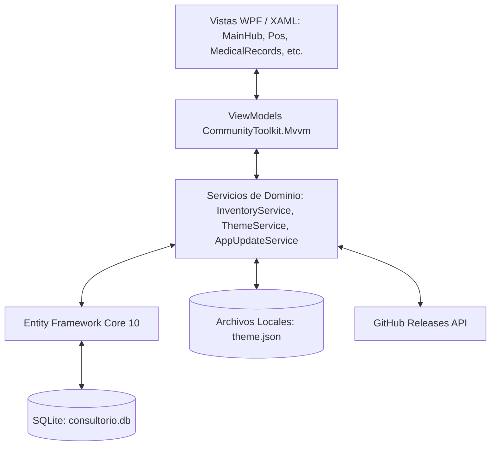
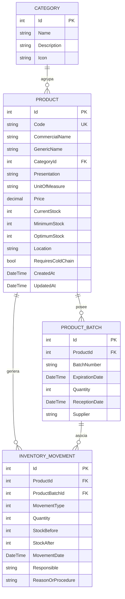

# Arquitectura Técnica - Sistema TPVC

Documentación técnica de arquitectura, diseño de software y decisiones de ingeniería para el sistema **TPVC (Inventario y Consultorio de Médico General)**.

---

## 1. Visión General de la Solución

TPVC es una aplicación de escritorio nativa para **Windows** desarrollada bajo la plataforma **.NET 10** y el framework de interfaz de usuario **WPF (Windows Presentation Foundation)**. El sistema está diseñado bajo una arquitectura desacoplada basada en el patrón de diseño **MVVM (Model - View - ViewModel)**, respaldada por un motor de base de datos relacional local **SQLite** administrado a través de **Entity Framework Core 10**.



### Principios de Diseño
1. **Vista Principal Dividida Operativa**: La vista inicial integra los dos pilares del flujo de trabajo clínico: **Expedientes Clínicos (TODO)** y **Punto de Venta (POS con Carrito)**, permitiendo conmutar entre vista dividida y vistas de pantalla completa.
2. **Reactividad Automática sin Botones Manuales**: El `InventoryService` expone un bus de eventos en memoria (`OnInventoryChanged`) que notifica a todos los ViewModels activos ante cualquier mutación de datos (compras, consumos, ventas o ajustes), refrescando el estado del sistema en tiempo real.
3. **Persistencia Autónoma y Portabilidad**: Cero dependencias de servicios en la nube para la operación clínica cotidiana. La base de datos es un archivo único `.db` alojado en el directorio de datos locales del usuario (`%LocalAppData%\TPVC\consultorio.db`).
4. **Seguridad Sanitaria Garantizada (FEFO)**: Tanto el consumo en consulta como las ventas en el POS priorizan automáticamente la deducción de los lotes con fecha de caducidad más próxima.
5. **La PC también será el servidor del consultorio** (Plan Fase 8, pasos 8.15–8.24; todavía no implementado): TPVC.exe atenderá a la tablet y al celular (app Android en Kotlin) por HTTPS en la red local y será el único equipo que escribe en `consultorio.db`. Turso quedará solo como respaldo de la PC. Con el servidor apagado, TPVC funcionará igual que hoy. Ver §10 y [`docs/PLAN_FASE8_VARIOS_EQUIPOS.md`](PLAN_FASE8_VARIOS_EQUIPOS.md).

---

## 2. Diagrama Entidad - Relación (Modelo de Datos)

El modelo de datos relacional está optimizado para garantizar trazabilidad histórica, auditoría inmutable y soporte de venta comercial / interna:



### Enumeraciones de Dominio
* **`MovementType`**:
  * `0`: `EntradaCompra` (Ingreso por factura de compra)
  * `1`: `EntradaAjuste` (Resurtido / donación)
  * `2`: `SalidaConsulta` (Material aplicado o consumido en consulta médica)
  * `3`: `SalidaCaducidad` (Baja de insumo por vencimiento)
  * `4`: `SalidaMerma` (Material dañado o rotura de esterilidad)
  * `5`: `AjusteInventario` (Alineación con conteo físico)
  * `6`: `SalidaVenta` (Venta en farmacia / Punto de Venta POS)
* **`ExpirationStatus`** (Calculado en tiempo de ejecución):
  * `Vigente`: Expiración a más de 60 días naturales.
  * `ProximoAVencer`: Expiración dentro de los próximos 60 días naturales.
  * `Vencido`: Fecha de expiración anterior a la fecha actual (`DateTime.Today`).

---

## 3. Algoritmo de Venta y Despacho en Punto de Venta (POS)

Cuando el personal procesa una venta en el Punto de Venta con Carrito, se ejecuta una transacción atómica que implementa **FEFO** sobre cada partida:


---

## 4. Arquitectura de la Vista Principal (Hub de Tres Cards y Shell de Configuración)

La Vista Principal (`MainHubView`) actúa como pantalla de bienvenida enfocada y libre de distracciones con **tres tarjetas interactivas de gran formato** (`BigActionCardStyle`):
* **Card 1: "Nueva Venta"**:
  * Ejecuta `OpenNewSaleCommand` en `MainHubViewModel`, delegando la navegación a `PosView` a través de `MainViewModel.NavigateTo("Pos")`.
  * Abre el flujo completo del Punto de Venta a pantalla completa con catálogo reactivo, control de carrito, selección de método de pago y despacho FEFO.
* **Card 2: "Nueva Consulta"**:
  * Ejecuta `OpenNewConsultationCommand` en `MainHubViewModel`, delegando la navegación a `MedicalRecordsView` a través de `MainViewModel.NavigateTo("Records")`.
  * Despliega en la cabecera un **banner hero en gran formato destacando "⚠️ MÓDULO EN DESARROLLO (TODO)"**, la hoja de ruta de la norma NOM-004-SSA3 y el visualizador maestro-detalle de expedientes.
* **Card 3: "Configuración"**:
  * Ejecuta `OpenConfigurationCommand` en `MainHubViewModel`, delegando la navegación a `ConfigurationShellView` a través de `MainViewModel.NavigateTo("Config")`.
  * **Panel Lateral Trasladado**: Alberga el panel lateral de navegación administrativa para alternar entre *Dashboard*, *Inventario*, *Lotes*, *Kardex* y *Temas/Ajustes*.
* **Navegación de Retorno Rápido**:
  * `PosView`, `MedicalRecordsView` y el panel lateral de `ConfigurationShellView` cuentan con el botón **"← Volver a Inicio"** (`BackToHubCommand`), permitiendo al usuario regresar inmediatamente a la pantalla de las tres tarjetas sin perder el estado de la sesión.
* **Interconexión Clínica**:
  * `MainViewModel` implementa el delegado `OnSendPrescriptionToPos`, permitiendo que el botón *"Cargar a Venta (POS)"* en el expediente del paciente envíe automáticamente los medicamentos recetados al carrito de compras del POS prellenando el nombre del paciente y navegando fluidamente al POS.

---

## 5. Motor de Temas y Estilos Dinámicos

La personalización de la interfaz se implementa a nivel del `ResourceDictionary` raíz de la aplicación mediante el servicio `ThemeService`:

### Estructura de Recursos Dinámicos (`Styles.xaml` & `ThemeService.cs`)
* `WindowBackgroundBrush`: Pincel de fondo de la ventana principal y diálogos.
* `CardBackgroundBrush`: Pincel de tarjetas de métricas, contenedores y paneles.
* `TextPrimaryBrush` / `TextSecondaryBrush`: Pinceles para textos de alta y media legibilidad.
* `PrimaryAccentBrush`: Pincel de marca aplicado a botones de acción, tabs activas y resaltados.
* `BorderBrush`: Pincel para divisores y bordes de tablas.

---

## 6. Estructura de Proyectos y Carpetas

Las carpetas marcadas *(plan Fase 8)* todavía no existen; se crean en el paso indicado.

```text
TPVC/
├── .github/
│   └── workflows/
│       └── ci.yml               # Pipeline de integración continua (Build & Test)
├── android/                     # (plan Fase 8) App Android en Kotlin, con su propio flujo de CI (android.yml); fase siguiente
├── contracts/                   # (plan Fase 8) Lo que comparten C# y Kotlin
│   ├── golden/                  # Vectores compartidos de reglas (paso 8.14)
│   └── lan-api/v1/              # openapi.json y examples/*.json del servidor del consultorio (pasos 8.19 y 8.24)
├── docs/
│   ├── MANUAL_DE_USUARIO.md     # Guía detallada para el personal médico
│   ├── PLAN_FASE8_VARIOS_EQUIPOS.md # Plan de la Fase 8: datos para varios equipos en la red local
│   └── ARQUITECTURA_TECNICA.md  # Este documento de ingeniería
├── Data/
│   ├── AppDbContext.cs          # Contexto EF Core SQLite
│   └── DatabaseInitializer.cs   # Migración preventiva y sembrado clínico
├── Models/
│   ├── Category.cs              # Entidad categoría médica
│   ├── Product.cs               # Entidad insumo / fármaco (con Price)
│   ├── ProductBatch.cs          # Entidad lote y control de vencimiento
│   ├── InventoryMovement.cs     # Entidad movimiento de Kardex (con SalidaVenta)
│   ├── PatientRecord.cs         # Modelo de expediente clínico del paciente
│   └── ThemeSettings.cs         # Modelo de configuración visual
├── Services/
│   ├── Documents/               # (plan Fase 8, paso 8.13) Generadores puros sin WPF: receta en HTML, ticket en texto y HTML
│   ├── Lan/                     # (plan Fase 8, pasos 8.16–8.24) Servidor del consultorio sin WPF: Kestrel, certificado, lan.db, rutas (§10)
│   ├── InventoryService.cs      # Lógica de inventario, FEFO y RegisterSaleAsync
│   ├── ThemeService.cs          # Motor de renderizado dinámico de temas
│   ├── TursoSyncService.cs      # Sincronización con Turso (protocolo v2)
│   ├── ConsultationHandoffService.cs # Consulta entre equipos (tabla ConsultationHandoffs)
│   └── AppUpdateService.cs      # Cliente de actualización vía GitHub Releases
├── ViewModels/
│   ├── MainViewModel.cs         # Orquestación de navegación y status bar
│   ├── MainHubViewModel.cs      # Orquestador de Vista Principal (Dividida / Full)
│   ├── PosViewModel.cs          # Punto de Venta, catálogo y Carrito de compras
│   ├── MedicalRecordsViewModel.cs # Pacientes en WPF: solo arma la plataforma; todo lo demás es de PatientsWorkspace (§9)
│   ├── DashboardViewModel.cs    # Métricas clínicas y KPIs
│   ├── InventoryViewModel.cs    # Catálogo, búsquedas y filtros
│   ├── BatchesViewModel.cs      # Control de lotes y semáforos
│   ├── MovementsViewModel.cs    # Auditoría de Kardex
│   ├── ConfigurationShellViewModel.cs # Secciones de Configuración, resúmenes y buscador de ajustes
│   ├── AppearanceViewModel.cs   # Modo, acento y colores propios con vista previa
│   ├── DataManagementViewModel.cs # Respaldos, importar Excel y restaurar base
│   ├── UpdatesViewModel.cs      # Versión, actualizaciones y token de GitHub
│   ├── ServicesCatalogViewModel.cs # Servicios, precios e insumos
│   ├── Patients/                # Módulo Pacientes sin WPF (TPVC.ViewModels.Patients, §9)
│   │   ├── Platform/            # Hilo de la interfaz, confirmaciones, enlaces e impresión (PatientsPlatform)
│   │   ├── Ports/               # Puertos del coordinador (flujos, avisos, candado, borrador y apartado)
│   │   ├── State/               # Estado compartido: expedientes, consulta en curso, cuenta, catálogo…
│   │   ├── Workspace/           # PatientsWorkspace: el coordinador del apartado
│   │   ├── ConsultationHandoffViewModel.cs # Enviar/recibir la consulta en curso entre equipos
│   │   └── …ViewModel.cs        # Una parte de la pantalla cada uno (inicio, ficha, alta, consulta, agenda, hojas)
│   └── ProductDialogViewModel.cs # Alta y edición de producto (panel lateral)
├── Views/
│   ├── MainWindow.xaml          # Ventana principal y barra de estado inferior
│   ├── MainHubView.xaml         # Vista principal dividida
│   ├── PosView.xaml             # Vista de Punto de Venta con Carrito
│   ├── MedicalRecordsView.xaml  # Vista de Expedientes Clínicos (TODO)
│   ├── DashboardView.xaml       # Panel de control y métricas
│   ├── InventoryView.xaml       # Vista de catálogo
│   ├── BatchesView.xaml         # Vista de lotes
│   ├── MovementsView.xaml       # Vista de movimientos
│   ├── ConfigurationShellView.xaml # Secciones y buscador de ajustes
│   ├── ServicesCatalogView.xaml # Servicios
│   ├── AppearanceView.xaml      # Apariencia con vista previa
│   ├── DataManagementView.xaml  # Respaldos y datos
│   ├── UpdatesView.xaml         # Acerca de y actualizaciones
│   ├── TursoSyncView.xaml       # Nube y dispositivos
│   └── SendConsultationSheetView.xaml # "Enviar a…" (consulta entre equipos)
├── tests/
│   └── TPVC.Tests/
│       ├── InventoryTests.cs    # Suite de 8 pruebas unitarias
│       └── TPVC.Tests.csproj    # Proyecto de pruebas MSTest
├── TPVC.csproj                  # Archivo de proyecto principal WPF .NET 10
├── TPVC.sln                     # Solución Visual Studio
├── CHANGELOG.md                 # Historial de versiones Keep a Changelog
├── LICENSE                      # Licencia de código abierto MIT
└── README.md                    # Portada y documentación de inicio rápido
```

---

## 7. Estrategia de Pruebas Automatizadas

El proyecto incluye 8 pruebas unitarias automatizadas en `tests/TPVC.Tests` utilizando **MSTest v3.5**:
1. **`DatabaseInitializer_SeedsGeneralMedicineCategoriesAndProducts`**: Valida el sembrado clínico inicial.
2. **`RegisterQuickConsultationUsage_DecreasesStockAndCreatesKardexMovement`**: Valida consumo en consulta con FEFO.
3. **`ProductBatch_ComputesExpirationStatusCorrectly`**: Valida la lógica de semáforo temporal.
4. **`DashboardMetrics_CalculatesCorrectTotals`**: Valida cómputo de KPIs agregados.
5. **`AppUpdateService_HasValidCurrentVersion`**: Valida el ensamblado de versiones.
6. **`RegisterSaleAsync_DecreasesStockAndCreatesSalidaVentaMovement`**: Valida la transacción de venta POS, deducción de existencias y registro en Kardex de tipo `SalidaVenta`.
7. **`PosViewModel_CartCalculationsAndLimitsWorkCorrectly`**: Valida operaciones del carrito de compra (agregar, incrementar sin exceder existencias, decrementar, vaciar y totales).
8. **`MedicalRecordsViewModel_LoadsPatientsAndDispatchesPrescriptions`**: Valida la carga de expedientes y el despacho de recetas al carrito del POS.
9. **`DataLayerTests`** (v1.5.0): concurrencia de lecturas, WAL, ventas persistidas con folio consecutivo, validación de stock transaccional, lotes y Kardex alineados, metadatos de sincronización, migración de una base v1.4.0, búsqueda sin acentos, respaldos y regresión de nota de consulta duplicada.

### Pruebas planeadas para varios equipos (Plan Fase 8)
Hoy la CI (`ci.yml`) corre solo en `windows-latest`: una vez en UTC y otra con la zona de México (`tzutil`); las de `Rendimiento` corren aparte. Lo siguiente todavía no existe:
* **Job de Linux** (paso 8.3): `ubuntu-latest` con `dotnet test --filter "TestCategory!=Windows&TestCategory!=Rendimiento"`, dos veces: en UTC y con `TZ=America/Mexico_City`. Las pruebas que crean tipos de WPF o necesitan DPAPI real (`UiSmokeTests` y las que fallen en Linux) se marcan `[TestCategory("Windows")]`. Se puede porque el proyecto de pruebas ya compila en Linux con `EnableWindowsTargeting` (`Directory.Build.props`). La CI de Windows sigue mandando para WPF.
* **Vectores compartidos** (paso 8.14): `contracts/golden/*.json` con la forma `{rule, culture: "es-MX", today, now, cases:[{name, input, expected}]}`. `GoldenVectorTests` compara contra ellos y los reescribe con `TPVC_WRITE_GOLDEN=1`; las pruebas JUnit de Kotlin leen los mismos archivos. Todo redondeo lleva un caso de punto medio (.NET usa redondeo bancario) y los desempates llevan nombres con acentos. Cambiar una regla sin regenerar los archivos rompe la CI.
* **Ejemplos del contrato** (pasos 8.19 y 8.24): `contracts/lan-api/v1/examples/*.json`, grabados con `TPVC_WRITE_CONTRACTS=1` y por `FakeTabletClient` (cliente de referencia en C# que vincula por TLS en loopback). Kotlin los reproduce con `MockWebServer` como si fuera la PC.
* **Deriva de OpenAPI** (paso 8.19): `contracts/lan-api/v1/openapi.json` se genera con `Microsoft.AspNetCore.OpenApi`, y una prueba falla si las rutas cambian sin regenerarlo.

---

## 8. Capa de Datos (v1.5.0) y Preparación para Servidor

### Contextos de vida corta
`InventoryService` recibe un `IDbContextFactory<AppDbContext>` y crea un contexto por operación:
* **Lecturas** con `AsNoTracking()`: varias vistas pueden recargar en paralelo (antes compartían un único `DbContext` y fallaban con *"A second operation was started on this context"*), la memoria no crece con el uso y los cambios hechos por otro proceso se ven en la siguiente lectura.
* **Escrituras atómicas**: una venta (validación de stock + FEFO + Kardex + ticket) o una recepción de lote ocurre en un solo `SaveChanges`/transacción; si algo falla no se guarda nada.
* Las entidades principales implementan **igualdad por `Id`**, para que la UI (ComboBox, listas, `Contains`) reconozca el mismo registro entre recargas.
* Eventos separados: `OnInventoryChanged` (productos, lotes, ventas, servicios) y `OnPatientsChanged` (expedientes y notas), para no recargar expedientes en cada venta.

### SQLite
* `journal_mode=WAL` (persistente) y por conexión `synchronous=NORMAL`, `busy_timeout=5000`, `foreign_keys=ON` (`SqlitePragmaInterceptor`).
* **Migración aditiva automática** (`DatabaseInitializer.EnsureSchema`): compara el modelo de EF con `sqlite_master`/`pragma_table_info` y crea tablas, columnas e índices faltantes. Una huella del modelo en `PRAGMA user_version` evita repetir la comparación en cada arranque.
* **Respaldos** con la API de backup en línea de SQLite (`BackupService`): uno diario automático + manual, se conservan 14.

### Metadatos de sincronización
Todas las entidades de negocio implementan `ISyncEntity`:

| Campo | Uso |
|---|---|
| `SyncId` (GUID, único) | Identidad global del registro; los `Id` enteros son locales a cada dispositivo. |
| `UpdatedAtUtc` (indexado) | Permite pedir "todo lo modificado desde X" (sincronización incremental). |
| `SyncTombstones` | Registro de borrados físicos para propagarlos a otros dispositivos. |
| `SyncChangeLog` *(plan Fase 8, paso 8.5)* | Registro de cambios que llenan triggers de SQLite (`AFTER INSERT/UPDATE/DELETE`) en las 13 tablas `ISyncEntity`: un renglón por registro (`EntityType`, `SyncId`, `Deleted`) con una secuencia `Seq` que solo sube; también registra los borrados en cascada. Será el cursor del respaldo a Turso y de los avisos a los equipos. Las entidades con triggers declararán `HasTrigger` (o `UseSqlReturningClause(false)`) para que EF Core no use `RETURNING`. |
| `DbMeta(Generation)` *(plan Fase 8, paso 8.5)* | GUID que cambia en cada restauración, para que los equipos sepan que la base cambió por completo. |
| `LanRequestLog` *(plan Fase 8, paso 8.20)* | Comandos ya aplicados por equipo (`deviceId`, `Idempotency-Key`, hash del cuerpo y respuesta), confirmados en la misma transacción que su efecto (§10). Vive en `consultorio.db` porque SQLite en modo WAL no confirma de forma atómica entre dos archivos. |

`AppDbContext.SaveChanges` asigna `SyncId` y `UpdatedAtUtc` y registra los `SyncTombstones` automáticamente. Los borrados de productos y pacientes siguen siendo lógicos (`IsActive = false`), por lo que también se sincronizan como actualización.

**Guardado de pacientes por campo** *(plan Fase 8, paso 8.9)*: hoy `InventoryService.SavePatientAsync` copia el objeto completo (`SetValues`), así que un guardado con una copia vieja puede pisar lo que escribió otro flujo. Con `PatientPatch`, cada cambio `{field, before, after}` se aplica solo si el valor actual es `before` (si ya es `after`, no hace nada; si no es ninguno, es conflicto), en una transacción (`InventoryService.SavePatientChangesAsync`) que devuelve los conflictos. Las hojas JSON se combinan por renglón con su `SyncId`. La PC y la API de la red usarán el mismo código.

**Servidor**: la idea anterior (intercambiar cambios con *last-write-wins* por `UpdatedAtUtc` y folios con prefijo por equipo) se descartó. En el plan Fase 8 solo la PC escribe y asigna los folios; ver §10.

### Ventas persistidas
Tablas `Sales` y `SaleItems`: cada ticket guarda folio consecutivo diario (`TKT-yyyyMMdd-0001`), cliente, método de pago, total y partidas (productos **y servicios clínicos**, que antes no quedaban registrados). Base para corte de caja y reportes de ingresos.

---

## 9. Módulo Pacientes (`ViewModels/Patients`, v1.19.0)

Desde la Fase 6 el apartado Pacientes (inicio, ficha, alta, consulta, receta, agenda y cobro de la consulta) ya no es un solo ViewModel de miles de líneas: cada parte de la pantalla tiene su **dueño** y un **coordinador**, `PatientsWorkspace`, corre los flujos que cruzan a varios dueños. Todo lo que está bajo `ViewModels/Patients/` (espacio de nombres `TPVC.ViewModels.Patients`) **no usa WPF**. Como la app Android será Kotlin nativo, este código no se reutiliza en la tablet: es la referencia de comportamiento, y en el plan Fase 8 puede correr sin pantalla en la PC para las consultas de la tablet (paso 8.21, ver *Sin pantalla en el servidor*; `docs/PENDIENTES_ANDROID.md`, B3). `MedicalRecordsViewModel` es una subclase sellada que solo arma la plataforma de WPF; las vistas (`d:DataContext`), `CachedViewConverter` (que busca `MedicalRecordsView` por el nombre del tipo), `MainViewModel`, `App` y las pruebas lo siguen usando con ese nombre. El detalle (decisiones, pasos y reglas de cada movimiento) está en [`docs/fase6/PLAN_DIVISION_VIEWMODEL.md`](fase6/PLAN_DIVISION_VIEWMODEL.md).

### Carpetas y niveles

Regla: un objeto solo recibe en su constructor objetos de **niveles anteriores**; lo demás lo pide al coordinador por sus puertos. `PatientsArchitectureTests` lo revisa por reflexión y además prohíbe en `ViewModels/Patients/**` cualquier rastro de WPF (`System.Windows`, `Application.Current`, `Dispatcher`, `DialogService`, `PrintingService`, `Process.Start`, `MessageBox`, `MedicalRecordsViewModel`).

| Carpeta | Nivel | Contenido |
|---|---|---|
| `Patients/Platform/` | 1 | Lo de la plataforma: `IUiThread` (`InlineUiThread` sin interfaz), `IUserDialogs`, `IUrlLauncher`, `IPrescriptionOutput`, agrupados en `PatientsPlatform`; `AutosaveOptions` y el atributo `[NotForBinding]`. |
| `Patients/State/` | 2–3 | Estado compartido sin pantalla propia (tabla siguiente). |
| `Patients/*ViewModel.cs`, `ConsultationAutosave.cs` | 4–7 | Una parte de la pantalla cada uno. |
| `Patients/Ports/` | — | Interfaces del coordinador (ver *Puertos*). |
| `Patients/Workspace/` | 8 | `PatientsWorkspace` en partes: `.cs` (construcción, `Dispose`, hijos y estado del apartado), `.Flows.cs` (flujos), `.Hubs.cs` y `.Ports.cs` (puertos), `.Facade.cs` (fachada) y `.Escape.cs` (Esc por capas y escribir para buscar). |
| `Helpers/WpfPlatform/` | WPF | `WpfUiThread`, `WpfUserDialogs` (sobre `DialogService`), `ShellUrlLauncher` y `WpfPatientsPlatform.Create(printingService)`; `PrintingService` implementa `IPrescriptionOutput` directamente. |
| `ViewModels/MedicalRecordsViewModel.cs` | WPF | `sealed class MedicalRecordsViewModel : PatientsWorkspace`: los mismos dos constructores de siempre, que pasan `WpfPatientsPlatform.Create(printingService)` a la base. |

### Dueños

El coordinador crea a cada hijo una sola vez, al inicio del constructor y sin efectos (no se suscriben a servicios ni disparan ganchos), y lo expone con una propiedad de solo lectura que nunca se reemplaza. Las vistas llegan a cada miembro por la ruta de su dueño (`Session.SelectedPatient.FullName`, `Agenda.IsAgendaPanelOpen`); no hay propiedades de reenvío que avisen.

| Propiedad | Tipo | Nivel | Es dueño de |
|---|---|---|---|
| `Info` | `InfoDialogState` | 2 | Ventana de aviso ("Notificación clínica") y su cierre a los 4 s. |
| `Feedback` | `PatientsFeedback` | 2 | Avisos breves (`ShowSuccess`, `ShowWarning`); sin servicio de avisos usa la ventana de aviso. |
| `Navigation` | `PatientsNavigation` | 2 | Página visible (inicio, ficha, alta, consulta), barra superior y foco al buscador. |
| `Clinic` | `ClinicInfo` | 2 | Médico y consultorio (receta, recordatorios de citas). |
| `Catalog` | `CatalogStore` | 2 | Servicios clínicos y productos del inventario. |
| `Templates` | `PrescriptionTemplateStore` | 2 | Posologías, medidas generales y reglas de dosis pediátrica. |
| `Session` | `PatientSession` | 2 | Expedientes, paciente seleccionado e historial de consultas. |
| `Active` | `ActiveConsultationSession` | 2 | Consulta en curso del servicio (folio, paciente, total) y su cronómetro. |
| `Record` | `ConsultationRecordState` | 3 | El expediente durante la consulta: receta anterior y resumen de antes (al descartar vuelve a como estaba). |
| `Account` | `ConsultationAccount` | 3 | Cuenta de la consulta: honorario y cargos (receta que se surte aquí, insumos y servicios). |
| `VitalsChart` | `VitalSignsChartViewModel` | 4 | Gráfica y tabla de signos vitales. |
| `CatalogBrowser` | `CatalogBrowserViewModel` | 4 | Explorador del catálogo que abren las hojas. |
| `Preview` | `PrescriptionPreviewViewModel` | 4 | Vista previa, impresión y exportación de la receta. |
| `Agenda` | `AgendaPanelViewModel` | 5 | Panel de agenda: semana, huecos, citas, mover, confirmar, cancelar y recordatorios. |
| `PatientForm` | `PatientFormViewModel` | 5 | Alta y edición de expediente y su borrador. |
| `Home` | `PatientsHomeViewModel` | 5 | Inicio: buscador, pacientes recientes y citas de hoy. |
| `Chart` | `PatientChartViewModel` | 5 | Ficha: antecedentes, historial, lo esencial, última receta y citas del paciente. |
| `Supplies`, `ClinicalServices` | `SuppliesSheetViewModel`, `ClinicalServicesSheetViewModel` | 5 | Hojas de insumos y de servicios. |
| `Prescription` | `PrescriptionSheetViewModel` | 5 | Hoja de receta: alerta de alergia, posología, dosis pediátrica, receta anterior y "Se surte aquí". |
| `Consultation` | `ConsultationViewModel` | 5 | Nota de la consulta, CIE-10, secciones, "Terminar consulta" y su cobro (`Checkout`). |
| `Autosave` | `ConsultationAutosave` | 6 | Borrador local de la consulta (contrato `ConsultationDraft`), indicador y consulta recuperada. |
| `Handoff` | `ConsultationHandoffViewModel` | 7 | Consulta entre equipos: enviar, solo lectura, recuperar, liberar y recibir. |

Cinco vistas sin código propio tienen como `DataContext` a su dueño: `PatientFormView` (`PatientForm`), `VitalSignsChartView` (`VitalsChart`), `InfoDialogView` (`Info`), `AllergyAlertView` (`Prescription`) y `SendConsultationSheetView` (`Handoff`). Las demás vistas de Pacientes usan el coordinador.

### Puertos

| Puerto | Lo implementa | Para qué |
|---|---|---|
| `IPatientsWorkflow` | `PatientsWorkspace` (explícito) | Flujos que un hijo le pide al coordinador: `SyncActiveConsultation`, `LoadPatientsAsync`, `LoadServicesAsync`, `OnConsultationChargedAsync`, `RefreshAgendaAfterChangeAsync`, `CloseConsultationSheets`… |
| `IPatientsHubs` | `PatientsWorkspace` (explícito) | Los ganchos generados de los hijos (`OnSelectedPatientChanged`, `OnPatientsPageChanged`, `OnServicesChanged`…) avisan aquí, en el mismo punto en que antes corría su cuerpo. |
| `IConsultationGate` | `PatientsWorkspace`, que responde con `Handoff` | Candado de la consulta: enviada a otro equipo o recibiendo una. |
| `IDraftHandoffParticipant` | `PatientsWorkspace`, que responde con `Handoff` | Lo del envío que guarda el borrador: la marca de "enviada" y la consulta recibida. |
| `IPatientsSection` | `PatientsWorkspace` (miembros públicos) | Lo que usan `MainViewModel`, `App` y las pruebas: la fachada `[NotForBinding]` (`Patients`, `SelectedPatient`, `HasActiveConsultation`, `StartActiveConsultation`…) más `InitialLoad`, `LoadPatientsAsync`, `EnterPatientsSection`, `FlushConsultationDraft`, `OnBackToHubRequested` y `Dispose`. |
| `IUiThread`, `IUserDialogs`, `IUrlLauncher`, `IPrescriptionOutput` | WPF: `WpfUiThread`, `WpfUserDialogs`, `ShellUrlLauncher`, `PrintingService`. Pruebas: `InlineUiThread` y las propias (en el plan Fase 8, también el servidor sin pantalla de 8.21). | La plataforma, que llega en `PatientsPlatform`. |

Los miembros de la fachada son atajos en C# a su dueño: nunca se avisan ni se enlazan desde XAML (`NotificationTargetsTests` y `XamlBindingContractTests` lo revisan).

### Flujos ordenados

Cada flujo que cruza dueños es **un solo método** del coordinador (`PatientsWorkspace.Flows.cs`), con el orden de siempre; cada paso escribe en su dueño.

- **Cambio de paciente** (`IPatientsHubs.OnSelectedPatientChanged`, desde el gancho de `Session`): reinicia "nota guardada" si cambió de verdad → dosis pediátrica → alerta de signos → `Chart.RefreshChartData` → `NotifyPatientsPageState` → con paciente: historial (más reciente primero), signos vitales, sus citas y, si viene del listado ligero, sus consultas; sin paciente: limpia los tres.
- **`SyncActiveConsultation`** (único suscriptor de `ConsultationService.OnActiveConsultationChanged`, además de las llamadas explícitas, incluido el doble aviso después de cobrar): `Active.RaiseConsultationChanged` → `NotifyAccountChanged` → cronómetro (o, sin consulta: detenerlo, borrar el honorario elegido y los datos de la consulta recibida, y cerrar la receta del expediente) → `Autosave` → `NotifyPatientsPageState` → `NotifyPrescriptionStateChanged` → `Handoff.NotifyHandoffState`.
- **Avisos que cruzan dueños:** `NotifyPatientsPageState` (banderas de página → aviso "Consulta en curso" → enlace de la ficha → aviso de consulta recibida); `NotifyPrescriptionStateChanged` (indicaciones de la vista previa → receta anterior → receta de la ficha); `NotifyAccountChanged` (consulta anterior → honorario y total de la cuenta → total de la consulta en curso).
- **Carga inicial:** `LoadPatientsAsync` → `LoadServicesAsync` (catálogo y luego las sugerencias de las tres hojas y el explorador) → plantillas de receta → citas de hoy → consulta recuperada → alta recuperada.
- **Constructor:** plataforma y servicios → hijos → `Autosave.Attach` → reglas del alta → citas → envío entre equipos → perfil del consultorio → consulta en curso → expedientes (o los de ejemplo sin base) → `SyncActiveConsultation`. **`Dispose`**, en el mismo orden de siempre: suscripciones → cronómetro → citas → envío → guardar borradores → temporizadores del borrador y del alta.
- **Cobro** (`HandleSaleCompletedFromConsultationAsync`): guarda la nota si faltaba → cierra la receta del expediente → cierra "Terminar consulta", las hojas, el alta y el aviso → cierra la consulta en el servicio y sincroniza → limpia la nota → sin paciente → la cita atendida queda "Atendida" → inicio.
- **Atender una cita** (`AttendAppointment`): inicia la consulta, escribe el motivo y deja la cita ligada al final; **Descartar** (`DiscardActiveConsultationAsync`) confirma, borra el avance guardado y deja la ficha como estaba.
- Dentro de un hijo: soltar una consulta enviada (`ReleaseHandedOffConsultation`, en `Handoff`) y aplicar el borrador (`ApplyConsultationDraft`, en `Autosave`) también son un solo método cada uno, en el orden de siempre.

### Pruebas que lo cuidan

`PatientsArchitectureTests` (sin WPF y niveles), `XamlBindingContractTests` (cada binding de las vistas se resuelve por reflexión; el manifiesto `TestAssets/fase6/patients-bindings.txt` muestra el dueño de cada uno), `NotificationParityTests` y `NotificationTargetsTests` (los mismos avisos, en el mismo orden y en el objeto correcto), `DraftContractTests` (borrador, envío entre equipos y alta: archivos de referencia que no cambian), `FlowCharacterizationTests`, `EscapeLadderTests`, `UiThreadSeamTests` y `PatientsWorkspaceReuseTests`, que crea `PatientsWorkspace` sin WPF (hilo en línea, confirmaciones escritas, impresora y enlaces que solo anotan) y corre una consulta completa: alta, receta que se surte aquí, cobro y una consulta recibida de otro equipo por la nube simulada.

### Sin pantalla en el servidor (plan Fase 8, paso 8.21)

Todavía no existe. Para que la tablet haga una consulta, la PC tiene que cumplir el contrato de la consulta (plan §3.8) dentro de su proceso. Se decide con una prueba de concepto:
- **(a) `RemoteConsultationHost`**, el primer intento: un `PatientsWorkspace` sin pantalla por cada consulta de la tablet, con su propio `ConsultationService` y su borrador por equipo, un hilo serial propio, diálogos que contestan según `confirm`, y sin impresión ni nube. Se empieza por aquí porque `PatientsWorkspaceReuseTests` ya corre una consulta completa sin WPF y `NotificationParityTests` ya tiene dos `ConsultationService` en el mismo proceso.
- **(b) `ConsultationEngine`**, el plan B: se extrae de `ConsultationAccount` y las hojas, y trabaja sobre el borrador. Se usa si (a) no pasa los criterios.
- En los dos casos, `OpenConsultationRegistry` lleva la consulta de la PC y las de la tablet, y no deja abrir dos veces al mismo paciente ni repetir un folio CNS.

Criterios de sí o no (son las pruebas del paso): la misma consulta por el motor y por la PC deja filas idénticas (nota, hojas, venta, movimientos y cita "Atendida"); contestar "No" a una confirmación no cambia nada; no corre ningún temporizador ni despachador de WPF; la memoria por consulta está medida y una consulta abandonada se cierra por tiempo; un reinicio de la PC la recupera. A la app de Kotlin le da igual si queda (a) o (b).

---

## 10. Servidor del consultorio (plan Fase 8)

**Nada de esta sección está implementado todavía.** Es el resumen técnico de [`docs/PLAN_FASE8_VARIOS_EQUIPOS.md`](PLAN_FASE8_VARIOS_EQUIPOS.md) (§2, §3 y pasos 8.15–8.24). Todo queda detrás del interruptor "Conectar tablet y celular por la red del consultorio", apagado por defecto: apagado, nada escucha y TPVC funciona igual que en v1.19.

### Quién escribe
- `consultorio.db` en la PC (`AppDbContext.DbPath`) es la única base de negocio. Solo la PC pone `UpdatedAtUtc`, asigna los folios EXP, TKT y CNS, y ejecuta el código de existencias (`RegisterSaleAsync`, `CancelSaleAsync`, FEFO con `DeductFromBatches`, `EnsureStock`).
- La tablet y el celular no escriben filas: mandan comandos y la PC los ejecuta con el mismo código que usan sus pantallas. Se refieren a los registros por `SyncId`; los `Id` enteros solo existen en la PC.

### Kestrel y certificado (pasos 8.15 y 8.16)
- HTTPS/1.1 con TLS 1.2 o 1.3, servido por Kestrel dentro de TPVC.exe (`Services/Lan/LanServerHost`) en el puerto TCP 47820 (configurable).
- Necesita `FrameworkReference Microsoft.AspNetCore.App`. Hoy TPVC se publica dependiente del runtime (`--self-contained false` en `scripts/build-installer.ps1` y `.sh`), así que la publicación autónoma va antes y sola (8.15).
- Certificado autofirmado ECDSA P-256, válido 10 años, creado la primera vez (`LanCertificateStore`). Se guarda como PFX en `%LocalAppData%\TPVC\lan\`, con su contraseña protegida por DPAPI como el token de Turso. Los equipos confían solo en el SHA-256 del SPKI que traía el QR. Si se reinstala la PC, hay que volver a vincular.
- Solo acepta direcciones privadas (RFC 1918 y link-local). Límites: 16 KB de encabezados, 4 MB de cuerpo, 30 s de inactividad y 16 conexiones.
- Descartados: `HttpListener` (fuera de localhost pide `netsh` como administrador), un servidor HTTP propio sobre `SslStream` y HTTP sin TLS.

### `lan.db` (`LanDbContext`, paso 8.16)
Archivo aparte con `PairedDevices`, `PairingCodes`, `LanAccessLog` (bitácora de accesos, se conserva al menos 5 años), `LanHandoffs` y `HostedConsultations`. Así, restaurar `consultorio.db` nunca revive un equipo quitado ni olvida uno nuevo. No entra en la huella de Turso ni en `EnsureSchema`. `LanRequestLog` se queda en `consultorio.db` (§8).

### Rutas (pasos 8.16–8.23)
- Todo bajo `/api/v1/`, JSON UTF-8 en camelCase; errores en `application/problem+json` con `title` en español, listo para mostrar.
- `GET /hello` y `POST /pair` van sin token. Las demás llevan `Authorization: Bearer tpvc1.<deviceId>.<secret>` y cada ruta declara su permiso de `DevicePermissions` (más `CanViewClinicalRecords` y `CanShareDocuments`, nuevos). Una prueba por reflexión revisa que todas lo declaren.
- Lecturas ya armadas para mostrar (inicio, pacientes, ficha, agenda, catálogo, reportes, inventario, tickets, perfil y documentos), calculadas con las funciones que ya existen (`RankPatients`, `BuildSlots`, `GetDailyCashCutAsync`…), con ETag.
- Escrituras: alta y cambios de pacientes, citas y ventas; la consulta de la tablet (`/consultations…`, contrato que no copia el interior de los ViewModels) y la consulta entre equipos (`/handoffs…`).
- Avisos por espera larga: `GET /events?after=<seq>&wait=25` sobre `SyncChangeLog`, que contesta en menos de 1 s tras un guardado. `409 generation_changed` si la base se restauró y `410 cursor_expired` si el cursor es demasiado viejo.
- Versiones: dentro de v1 solo cambios aditivos; un cambio incompatible abre `/api/v2/`. Una app vieja recibe `426 protocol_unsupported`. El contrato queda en `contracts/lan-api/v1/openapi.json` (§7).

### Idempotencia (pasos 8.12 y 8.20)
- Todo `POST`, `PATCH` y `PUT` lleva `Idempotency-Key` (UUID generado en el equipo), y las altas llevan el `syncId` del registro nuevo, también generado en el equipo.
- La PC guarda `(deviceId, Idempotency-Key)`, el hash del cuerpo y la respuesta en `LanRequestLog`, **en la misma transacción que el efecto**. Misma clave y mismo cuerpo: devuelve la respuesta guardada, sin una segunda venta. Misma clave con otro cuerpo: `422 idempotency_mismatch`. El registro se depura a los 7 días.
- La PC aplica los comandos de cada equipo de uno en uno, en orden.
- Por eso terminar la consulta pasa a ser una sola transacción (`ConsultationFinishService`, 8.12): nota, resumen del paciente, hojas, venta con FEFO y cita "Atendida" en un solo `SaveChanges`.
- Escrituras del servidor y de la UI al mismo tiempo: WAL, `busy_timeout`, `SqlitePoolOpenGuard` y una prueba de estrés.

### Despachador de avisos (paso 8.11)
Hoy `InventoryService.Raise` llama a los suscriptores en el hilo que hizo el cambio, y las pantallas de la PC suponen el hilo de la UI. Con el servidor, los cambios también llegarán desde hilos de Kestrel. `Raise` pasará por un `IChangeEventDispatcher` inyectable (`Dispatcher.BeginInvoke` en WPF, el mismo hilo en las pruebas), y `TursoSyncService.RunOnUiThread` usará el mismo. Los avisos a los equipos no pasan por estos eventos: salen de `SyncChangeLog` por `/events`.

### Política al restaurar (pasos 8.7 y 8.16)
- Las vinculaciones se quedan (`lan.db` no se restaura).
- La `Generation` cambia: los equipos reciben `409 generation_changed`, borran lo que tenían guardado y vuelven a pedirlo. Un comando creado bajo otra generación nunca se reenvía solo; la app muestra "La PC restauró un respaldo: revise estos pendientes".
- Los envíos y las consultas de la tablet que ya no coinciden con la base restaurada se cancelan y se muestran al médico.
- Con la nube activa, la PC pregunta si reemplaza la copia de Turso (`docs/TURSO_SYNC_ARCHITECTURE.md` §7).
