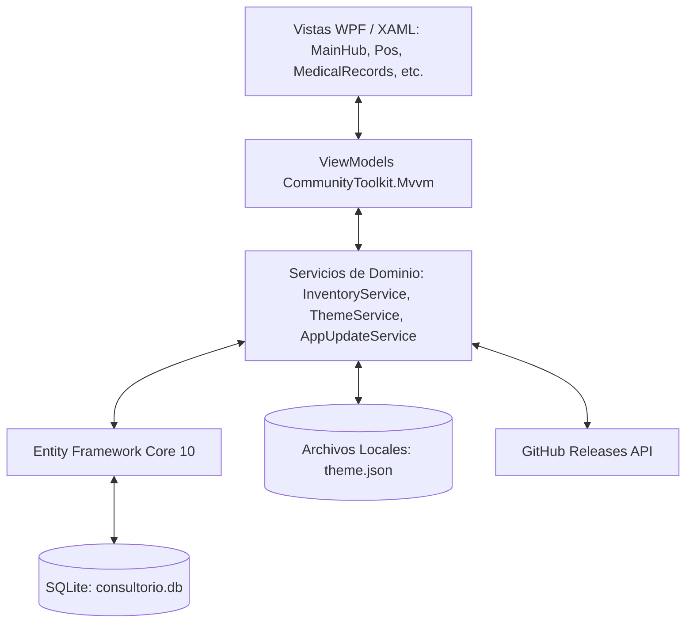
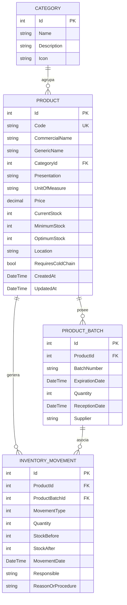
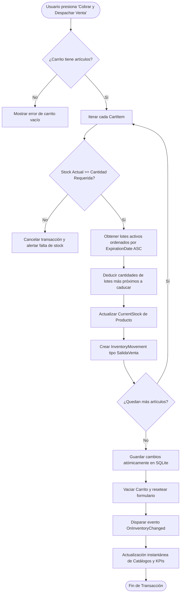

# Arquitectura Técnica - Sistema TPVC

Documentación técnica de arquitectura, diseño de software y decisiones de ingeniería para el sistema **TPVC (Inventario y Consultorio de Médico General)**.

---

## 1. Visión General de la Solución

TPVC es una aplicación de escritorio nativa para **Windows** desarrollada bajo la plataforma **.NET 10** y el framework de interfaz de usuario **WPF (Windows Presentation Foundation)**. El sistema está diseñado bajo una arquitectura desacoplada basada en el patrón de diseño **MVVM (Model - View - ViewModel)**, respaldada por un motor de base de datos relacional local **SQLite** administrado a través de **Entity Framework Core 10**.



### Principios de Diseño
1. **Vista Principal Dividida Operativa**: La vista inicial integra los dos pilares del flujo de trabajo clínico: **Expedientes Clínicos (TODO)** y **Punto de Venta (POS con Carrito)**, permitiendo conmutar entre vista dividida y vistas de pantalla completa.
2. **Reactividad Automática sin Botones Manuales**: El `InventoryService` expone un bus de eventos en memoria (`OnInventoryChanged`) que notifica a todos los ViewModels activos ante cualquier mutación de datos (compras, consumos, ventas o ajustes), refrescando el estado del sistema en tiempo real.
3. **Persistencia Autónoma y Portabilidad**: Cero dependencias de servicios en la nube para la operación clínica cotidiana. La base de datos es un archivo único `.db` alojado en el directorio de datos locales del usuario (`%LocalAppData%\TPVC\consultorio.db`).
4. **Seguridad Sanitaria Garantizada (FEFO)**: Tanto el consumo en consulta como las ventas en el POS priorizan automáticamente la deducción de los lotes con fecha de caducidad más próxima.
5. **Tres equipos con su propia base, sincronizados por Turso** (Plan Fase 8; todavía no implementado): la PC, una tablet y un celular Android (app en Kotlin nativo) trabajan cada uno sobre su base local y se sincronizan por Turso con el protocolo v2 (`docs/TURSO_SYNC_ARCHITECTURE.md` §4). La PC es la única que crea o migra el esquema remoto y es la referencia del protocolo. Con la nube apagada, TPVC funciona igual que hoy. Ver §10 y [`docs/PLAN_FASE8_VARIOS_EQUIPOS.md`](PLAN_FASE8_VARIOS_EQUIPOS.md).

---

## 2. Diagrama Entidad - Relación (Modelo de Datos)

El modelo de datos relacional está optimizado para garantizar trazabilidad histórica, auditoría inmutable y soporte de venta comercial / interna:



### Enumeraciones de Dominio
* **`MovementType`**:
  * `0`: `EntradaCompra` (Ingreso por factura de compra)
  * `1`: `EntradaAjuste` (Resurtido / donación)
  * `2`: `SalidaConsulta` (Material aplicado o consumido en consulta médica)
  * `3`: `SalidaCaducidad` (Baja de insumo por vencimiento)
  * `4`: `SalidaMerma` (Material dañado o rotura de esterilidad)
  * `5`: `AjusteInventario` (Alineación con conteo físico)
  * `6`: `SalidaVenta` (Venta en farmacia / Punto de Venta POS)
  * `7`: `EntradaDevolucion` (Devolución por cancelación de ticket)
* **`ExpirationStatus`** (Calculado en tiempo de ejecución):
  * `Vigente`: Expiración a más de 60 días naturales.
  * `ProximoAVencer`: Expiración dentro de los próximos 60 días naturales.
  * `Vencido`: Fecha de expiración anterior a la fecha actual (`DateTime.Today`).

---

## 3. Algoritmo de Venta y Despacho en Punto de Venta (POS)

Cuando el personal procesa una venta en el Punto de Venta con Carrito, se ejecuta una transacción atómica que implementa **FEFO** sobre cada partida:



---

## 4. Arquitectura de la Vista Principal (Hub de Tres Cards y Shell de Configuración)

La Vista Principal (`MainHubView`) actúa como pantalla de bienvenida enfocada y libre de distracciones con **tres tarjetas interactivas de gran formato** (`BigActionCardStyle`):
* **Card 1: "Nueva Venta"**:
  * Ejecuta `OpenNewSaleCommand` en `MainHubViewModel`, delegando la navegación a `PosView` a través de `MainViewModel.NavigateTo("Pos")`.
  * Abre el flujo completo del Punto de Venta a pantalla completa con catálogo reactivo, control de carrito, selección de método de pago y despacho FEFO.
* **Card 2: "Nueva Consulta"**:
  * Ejecuta `OpenNewConsultationCommand` en `MainHubViewModel`, delegando la navegación a `MedicalRecordsView` a través de `MainViewModel.NavigateTo("Records")`.
  * Despliega en la cabecera un **banner hero en gran formato destacando "⚠️ MÓDULO EN DESARROLLO (TODO)"**, la hoja de ruta de la norma NOM-004-SSA3 y el visualizador maestro-detalle de expedientes.
* **Card 3: "Configuración"**:
  * Ejecuta `OpenConfigurationCommand` en `MainHubViewModel`, delegando la navegación a `ConfigurationShellView` a través de `MainViewModel.NavigateTo("Config")`.
  * **Panel Lateral Trasladado**: Alberga el panel lateral de navegación administrativa para alternar entre *Dashboard*, *Inventario*, *Lotes*, *Kardex* y *Temas/Ajustes*.
* **Navegación de Retorno Rápido**:
  * `PosView`, `MedicalRecordsView` y el panel lateral de `ConfigurationShellView` cuentan con el botón **"← Volver a Inicio"** (`BackToHubCommand`), permitiendo al usuario regresar inmediatamente a la pantalla de las tres tarjetas sin perder el estado de la sesión.
* **Interconexión Clínica**:
  * `MainViewModel` implementa el delegado `OnSendPrescriptionToPos`, permitiendo que el botón *"Cargar a Venta (POS)"* en el expediente del paciente envíe automáticamente los medicamentos recetados al carrito de compras del POS prellenando el nombre del paciente y navegando fluidamente al POS.

---

## 5. Motor de Temas y Estilos Dinámicos

La personalización de la interfaz se implementa a nivel del `ResourceDictionary` raíz de la aplicación mediante el servicio `ThemeService`:

### Estructura de Recursos Dinámicos (`Styles.xaml` & `ThemeService.cs`)
* `WindowBackgroundBrush`: Pincel de fondo de la ventana principal y diálogos.
* `CardBackgroundBrush`: Pincel de tarjetas de métricas, contenedores y paneles.
* `TextPrimaryBrush` / `TextSecondaryBrush`: Pinceles para textos de alta y media legibilidad.
* `PrimaryAccentBrush`: Pincel de marca aplicado a botones de acción, tabs activas y resaltados.
* `BorderBrush`: Pincel para divisores y bordes de tablas.

---

## 6. Estructura de Proyectos y Carpetas

Las carpetas marcadas *(plan Fase 8)* todavía no existen; se crean en el paso indicado.

```text
TPVC/
├── .github/
│   └── workflows/
│       └── ci.yml               # Pipeline de integración continua (Build & Test)
├── android/                     # (plan Fase 8) App Android en Kotlin, con su propio flujo de CI (android.yml); fase siguiente
├── contracts/                   # (plan Fase 8) Lo que comparten C# y Kotlin
│   ├── sync/                    # schema.json: contrato de sincronización generado desde GetTableMaps (paso 8.3)
│   ├── golden/                  # Vectores compartidos de reglas (pasos 8.3, 8.11 y 8.26)
│   ├── hrana/                   # Intercambios grabados con FakeHranaServer y el SQL literal que repite Kotlin (pasos 8.13 y 8.25)
│   └── scenarios/               # Escenarios de varios equipos: filas esperadas en la nube y en cada equipo (paso 8.25)
├── docs/
│   ├── MANUAL_DE_USUARIO.md     # Guía detallada para el personal médico
│   ├── EVALUACION_RESULTADOS_LABORATORIO.md # Dónde guardar los resultados de laboratorio (Turso + copia en la laptop; paso 8.12b)
│   ├── PLAN_FASE8_VARIOS_EQUIPOS.md # Plan de la Fase 8: datos listos para tres equipos con Turso
│   ├── FAKE_HRANA_SPEC.md       # (plan Fase 8, paso 8.13) Qué copia de Turso el servidor simulado
│   └── ARQUITECTURA_TECNICA.md  # Este documento de ingeniería
├── Helpers/
│   └── SingleInstanceGuard.cs   # Una sola ventana por base: la segunda apertura trae al frente la primera (desde v1.20.7)
├── Data/
│   ├── AppDbContext.cs          # Contexto EF Core SQLite
│   └── DatabaseInitializer.cs   # Migración preventiva y sembrado clínico
├── Models/
│   ├── Category.cs              # Entidad categoría médica
│   ├── Product.cs               # Entidad insumo / fármaco (con Price; desde v1.21.0 UnitCost y CostExcludesVat; desde v1.22.0 SupplierCode)
│   ├── ProductBatch.cs          # Entidad lote y control de vencimiento
│   ├── InventoryMovement.cs     # Entidad movimiento de Kardex (con SalidaVenta)
│   ├── PatientRecord.cs         # Modelo de expediente clínico del paciente (la consulta con LabOrderJson desde v1.25.0)
│   ├── LabOrder.cs              # Orden de laboratorio de la consulta: estudios e indicaciones, en JSON (v1.25.0)
│   ├── LabOrderSheet.cs         # La solicitud de laboratorio impresa: membrete de la receta y estudios por área (v1.25.0)
│   ├── ClinicClock.cs           # (paso 8.11, v1.28.0) "Hoy" del consultorio (edad, citas, caducidad, resumen), reemplazable en pruebas con ClinicClock.Use
│   └── ThemeSettings.cs         # Modelo de configuración visual
├── Services/
│   ├── Documents/               # (paso 8.11, v1.28.0) Generadores sin WPF: receta y solicitud de laboratorio en HTML (PrescriptionHtmlBuilder, LabOrderHtmlBuilder, LetterheadHtml/Layout), ticket en texto de 42 columnas y en HTML (TicketText, TicketHtml)
│   ├── Rules/                   # (paso 8.11, v1.28.0) Reglas sin WPF ni base: CashCutRules, StockAlertRules, SuggestedPurchaseRules, VitalSignsRules, PatientFormRules, HandoffPayloadCodec
│   ├── Pairing/                 # (plan Fase 8, paso 8.14) Vinculación por QR en la red local (LanPairingHost: TcpListener solo en direcciones privadas, 10 min)
│   ├── InventoryService.cs      # Lógica de inventario, FEFO y RegisterSaleAsync
│   ├── InventoryService.SupplierOrders.cs # «Ingresar pedido» (v1.22.0): emparejar renglones con el catálogo y recibir todo en una transacción
│   ├── SupplierOrderParser.cs   # Lee el pedido del correo del proveedor pegado como texto (formato de LUIN)
│   ├── PrescriptionNaming.cs    # El medicamento de la receta en el orden normado (RIS arts. 30–31): genérico, concentración, forma, (marca); v1.23.0
│   ├── LabCatalog.cs            # Estudios de laboratorio por área, frecuentes, paquetes e indicaciones; búsqueda sin acentos (v1.25.0)
│   ├── PrintingService.LabOrder.cs # Solicitud de laboratorio: FlowDocument, papel (media carta o carta) y HTML/PDF; comparte el membrete con la receta
│   ├── ThemeService.cs          # Motor de renderizado dinámico de temas
│   ├── TursoSyncService.cs      # Sincronización con Turso (protocolo v2; desde v1.26.0 el 3, con la cerca de generación)
│   ├── TursoSyncService.Generations.cs # Paso 8.9: generación de la nube, reemplazarla con un respaldo, desconectar, guardar y «Volver a aplicar»
│   ├── TursoSyncService.Devices.cs # Paso 8.10: latido, DeviceRegistry, PC principal, «Quitar» y DeviceId repetido
│   ├── TursoSyncService.ClinicAssets.cs # Paso 8.12: el membrete en la nube (ClinicAssets por hash, en trozos)
│   ├── TursoSyncService.LabFiles.cs # Paso 8.12b: los archivos de los resultados de laboratorio en la nube (LabBlobs y LabBlobChunks), tope de 2 GB, desalojo y huérfanos
│   ├── LabResultService.cs      # Paso 8.12b: resultados de laboratorio del expediente (LabResults) y su archivo en esta PC
│   ├── LabFiles/                # Paso 8.12b: LabFileStore (archivo por SHA-256 en %LocalAppData%\TPVC\laboratorio, y su respaldo externo), LabFileImporter (fotos a JPEG de 2000 px, PDF tal cual) y JpegPdfWriter (varias fotos en un PDF)
│   ├── TursoSyncService.LabFiles.cs # Paso 8.12b: archivos de los resultados de laboratorio en la nube (LabBlobs y LabBlobChunks), tope de 2 GB, desalojo y huérfanos
│   ├── LabResultService.cs      # Paso 8.12b: resultados de laboratorio del expediente (LabResults) y su archivo en esta PC
│   ├── LabFiles/                # Paso 8.12b: LabFileStore (archivo por SHA-256 en %LocalAppData%TPVCaboratorio y respaldo externo), LabFileImporter (fotos a JPEG de 2000 px, PDF tal cual) y JpegPdfWriter (varias fotos en un PDF)
│   ├── ConsultationHandoffService.cs # Consulta entre equipos (tabla ConsultationHandoffs)
│   └── AppUpdateService.cs      # Cliente de actualización vía GitHub Releases
├── ViewModels/
│   ├── MainViewModel.cs         # Orquestación de navegación y status bar
│   ├── MainHubViewModel.cs      # Orquestador de Vista Principal (Dividida / Full)
│   ├── PosViewModel.cs          # Punto de Venta, catálogo y Carrito de compras
│   ├── MedicalRecordsViewModel.cs # Pacientes en WPF: solo arma la plataforma; todo lo demás es de PatientsWorkspace (§9)
│   ├── DashboardViewModel.cs    # Métricas clínicas y KPIs
│   ├── InventoryViewModel.cs    # Catálogo, búsquedas y filtros
│   ├── BatchesViewModel.cs      # Control de lotes y semáforos
│   ├── MovementsViewModel.cs    # Auditoría de Kardex
│   ├── ConfigurationShellViewModel.cs # Secciones de Configuración, resúmenes y buscador de ajustes
│   ├── AppearanceViewModel.cs   # Modo, acento y colores propios con vista previa
│   ├── DataManagementViewModel.cs # Respaldos, importar Excel y restaurar base
│   ├── UpdatesViewModel.cs      # Versión, actualizaciones y token de GitHub
│   ├── ServicesCatalogViewModel.cs # Servicios, precios e insumos
│   ├── Patients/                # Módulo Pacientes sin WPF (TPVC.ViewModels.Patients, §9)
│   │   ├── Platform/            # Hilo de la interfaz, confirmaciones, enlaces e impresión (PatientsPlatform)
│   │   ├── Ports/               # Puertos del coordinador (flujos, avisos, candado, borrador y apartado)
│   │   ├── State/               # Estado compartido: expedientes, consulta en curso, cuenta, catálogo…
│   │   ├── Workspace/           # PatientsWorkspace: el coordinador del apartado
│   │   ├── ConsultationHandoffViewModel.cs # Enviar/recibir la consulta en curso entre equipos
│   │   └── …ViewModel.cs        # Una parte de la pantalla cada uno (inicio, ficha, alta, consulta, agenda, hojas)
│   └── ProductDialogViewModel.cs # Alta y edición de producto (panel lateral)
├── Views/
│   ├── MainWindow.xaml          # Ventana principal y barra de estado inferior
│   ├── MainHubView.xaml         # Vista principal dividida
│   ├── PosView.xaml             # Vista de Punto de Venta con Carrito
│   ├── MedicalRecordsView.xaml  # Vista de Expedientes Clínicos (TODO)
│   ├── DashboardView.xaml       # Panel de control y métricas
│   ├── InventoryView.xaml       # Vista de catálogo
│   ├── BatchesView.xaml         # Vista de lotes
│   ├── MovementsView.xaml       # Vista de movimientos
│   ├── ConfigurationShellView.xaml # Secciones y buscador de ajustes
│   ├── ServicesCatalogView.xaml # Servicios
│   ├── AppearanceView.xaml      # Apariencia con vista previa
│   ├── DataManagementView.xaml  # Respaldos y datos
│   ├── UpdatesView.xaml         # Acerca de y actualizaciones
│   ├── TursoSyncView.xaml       # Nube y dispositivos
│   └── SendConsultationSheetView.xaml # "Enviar a…" (consulta entre equipos)
├── tests/
│   └── TPVC.Tests/
│       ├── InventoryTests.cs    # Suite de 8 pruebas unitarias
│       └── TPVC.Tests.csproj    # Proyecto de pruebas MSTest
├── TPVC.csproj                  # Archivo de proyecto principal WPF .NET 10
├── TPVC.sln                     # Solución Visual Studio
├── CHANGELOG.md                 # Historial de versiones Keep a Changelog
├── LICENSE                      # Licencia de código abierto MIT
└── README.md                    # Portada y documentación de inicio rápido
```

---

## 7. Estrategia de Pruebas Automatizadas

El proyecto incluye 8 pruebas unitarias automatizadas en `tests/TPVC.Tests` utilizando **MSTest v3.5**:
1. **`DatabaseInitializer_SeedsGeneralMedicineCategoriesAndProducts`**: Valida el sembrado clínico inicial.
2. **`RegisterQuickConsultationUsage_DecreasesStockAndCreatesKardexMovement`**: Valida consumo en consulta con FEFO.
3. **`ProductBatch_ComputesExpirationStatusCorrectly`**: Valida la lógica de semáforo temporal.
4. **`DashboardMetrics_CalculatesCorrectTotals`**: Valida cómputo de KPIs agregados.
5. **`AppUpdateService_HasValidCurrentVersion`**: Valida el ensamblado de versiones.
6. **`RegisterSaleAsync_DecreasesStockAndCreatesSalidaVentaMovement`**: Valida la transacción de venta POS, deducción de existencias y registro en Kardex de tipo `SalidaVenta`.
7. **`PosViewModel_CartCalculationsAndLimitsWorkCorrectly`**: Valida operaciones del carrito de compra (agregar, incrementar sin exceder existencias, decrementar, vaciar y totales).
8. **`MedicalRecordsViewModel_LoadsPatientsAndDispatchesPrescriptions`**: Valida la carga de expedientes y el despacho de recetas al carrito del POS.
9. **`DataLayerTests`** (v1.5.0): concurrencia de lecturas, WAL, ventas persistidas con folio consecutivo, validación de stock transaccional, lotes y Kardex alineados, metadatos de sincronización, migración de una base v1.4.0, búsqueda sin acentos, respaldos y regresión de nota de consulta duplicada.

### Pruebas para varios equipos (Plan Fase 8)
La CI (`ci.yml`) corre en `windows-latest` todas las pruebas, una vez en UTC y otra con la zona de México (`tzutil`); las de `Rendimiento` corren aparte. Desde v1.20.0 (paso 8.2) existen el job de Linux y los primeros instrumentos de `FakeHranaServer`; lo demás de esta lista llega con su paso:
* **Job de Linux** (paso 8.2, hecho en v1.20.0): `ubuntu-latest` con `dotnet test --filter "TestCategory!=Windows&TestCategory!=Rendimiento"`, dos veces: en UTC y con `TZ=America/Mexico_City`. El proyecto de pruebas es `net10.0-windows` con `UseWPF`, y su testhost exige `Microsoft.WindowsDesktop.App`, que `setup-dotnet` no instala en Linux: `EnableWindowsTargeting` (`Directory.Build.props`) permite compilar, no ejecutar. Por eso el job descarga el `windowsdesktop-runtime-10.0.x-win-x64.zip` oficial, con versión fijada, y copia `shared/Microsoft.WindowsDesktop.App` a `$DOTNET_ROOT/shared`; como esos ensamblados vienen precompilados (ReadyToRun) para Windows y Linux los rechaza, `scripts/strip-readytorun.ps1` los deja como IL puro. Las pruebas que crean tipos de WPF o necesitan DPAPI real (`UiSmokeTests` y las que fallen en Linux) se marcan `[TestCategory("Windows")]`. La CI de Windows sigue mandando para WPF.
* **Vectores compartidos** (pasos 8.3, 8.11 y 8.26; los del 8.3 hechos en v1.20.1: `values`, `lww`, `stamping` y `uuid5`; los del 8.11 en v1.28.0: `cash-cut`, `alerts`, `suggested-purchase`, `prescription-sheet`, `prescription-html-fields` y `ticket-text`; ver `contracts/README.md`): `contracts/golden/*.json` con la forma `{rule, culture: "es-MX", today, now, cases:[{name, input, expected}]}`. `GoldenVectorTests` compara contra ellos y los reescribe con `TPVC_WRITE_GOLDEN=1`; las pruebas JUnit de Kotlin leen los mismos archivos. Todo redondeo lleva un caso de punto medio (.NET usa redondeo bancario) y los desempates llevan nombres con acentos. Cambiar una regla sin regenerar los archivos rompe la CI.
* **Deriva del contrato** (paso 8.3, hecho en v1.20.1): `contracts/sync/schema.json` se genera desde `Services/SyncSchema.cs`, el mismo mapeo que usa el motor; un cambio en el modelo de EF sin regenerarlo rompe la CI, y al regenerarlo `GoldenVectorTests` exige que solo agregue y que suba `SyncContract.Revision`.
* **Intercambios grabados** (pasos 8.13 y 8.25): `contracts/hrana/*.jsonl`, grabados por `FakeHranaServer` con los valores generados reemplazados por marcadores, más el SQL **literal** de cada instrucción que Kotlin tiene que repetir (un índice parcial solo se usa si el `WHERE` repite su condición). Kotlin los reproduce con `MockWebServer`.
* **Escenarios de varios equipos** (paso 8.25): `contracts/scenarios/*.json`, pasos por estado (editar, sincronizar en el equipo A o B, salto de reloj, corte a media subida) con las filas esperadas en la nube y en cada equipo, por `SyncId`. La CI de Kotlin los corre con el motor de la PC y el de Kotlin sobre el mismo servidor simulado.
* **Instrumentos de `FakeHranaServer`** (`tests/TPVC.Tests/FakeHranaServer.cs`; pasos 8.2, 8.13 y 8.14). Hechos en v1.20.0: reloj del servidor (`Clock`, reemplaza `'now'`), estimación de filas leídas y escritas cobradas (`BilledRowsRead`: pasos de recorrido completo de SQLite, filas que entran a un ordenamiento antes del `LIMIT`, filas devueltas o cambiadas, la tabla entera en `ALTER` y `CREATE INDEX`; mínimo 1 por instrucción), grabadora (`Requests`), revisión con `EXPLAIN QUERY PLAN` (`ScanPolicy`), tope de respuesta (`MaxResponseBytes`) y `BLOCKED` a pedido (`Blocked`). En v1.20.4 (paso 8.6): peticiones `batch` con condiciones y `BEGIN`/`COMMIT` reales, atómicas como en Turso (V14); la revisión de planes falla ante un SCAN de una tabla sincronizada (antes solo avisaba); un ordenamiento solo del último término ("LAST TERM OF ORDER BY") ya no cuenta como leer todas las candidatas; y `FailWhen` para hacer fallar una instrucción. Prueba base: una sincronización sin cambios = 1 petición (hasta v1.20.3 eran 16). Plan completo: reloj del servidor inyectable, estimación de lecturas cobradas, grabadora de peticiones, revisión con `EXPLAIN QUERY PLAN` (falla ante un SCAN de una tabla sincronizada desde 8.6), tope de tamaño de respuesta, respuesta `BLOCKED` a pedido y mapa de tokens (uno desconocido o rotado recibe 401). Se expone como servidor HTTP de pruebas (`TPVC_FAKE_TURSO_HOST=1`) que escucha solo en 127.0.0.1 y nunca entra a `TPVC.exe`. Qué copia de Turso queda en `docs/FAKE_HRANA_SPEC.md`.

---

## 8. Capa de Datos (v1.5.0) y Preparación para Varios Equipos

### Contextos de vida corta
`InventoryService` recibe un `IDbContextFactory<AppDbContext>` y crea un contexto por operación:
* **Lecturas** con `AsNoTracking()`: varias vistas pueden recargar en paralelo (antes compartían un único `DbContext` y fallaban con *"A second operation was started on this context"*), la memoria no crece con el uso y los cambios hechos por otro proceso se ven en la siguiente lectura.
* **Escrituras atómicas**: una venta (validación de stock + FEFO + Kardex + ticket) o una recepción de lote ocurre en un solo `SaveChanges`/transacción; si algo falla no se guarda nada.
* Las entidades principales implementan **igualdad por `Id`**, para que la UI (ComboBox, listas, `Contains`) reconozca el mismo registro entre recargas.
* Eventos separados: `OnInventoryChanged` (productos, lotes, ventas, servicios) y `OnPatientsChanged` (expedientes y notas), para no recargar expedientes en cada venta.

### SQLite
* `journal_mode=WAL` (persistente) y por conexión `synchronous=NORMAL`, `busy_timeout=5000`, `foreign_keys=ON` (`SqlitePragmaInterceptor`).
* **Migración aditiva automática** (`DatabaseInitializer.EnsureSchema`): compara el modelo de EF con `sqlite_master`/`pragma_table_info` y crea tablas, columnas e índices faltantes. Una huella del modelo en `PRAGMA user_version` evita repetir la comparación en cada arranque.
* **Respaldos** con la API de backup en línea de SQLite (`BackupService`): uno diario automático + manual, se conservan 14.
* **Una sola ventana por base** (desde v1.20.7, `Helpers/SingleInstanceGuard.cs`): al arrancar, antes de tocar la base, `App.OnStartup` toma un mutex con nombre (`Local\TPVC-<hash de la ruta de la base>-instancia`, por sesión de Windows). Si ya lo tiene otra instancia (doble clic en el escritorio o el menú de inicio con TPVC abierto), le avisa con un semáforo con nombre, cede el primer plano (`AllowSetForegroundWindow`) y termina; la primera restaura y activa su ventana y responde con otro semáforo. Semáforos y no eventos: dos aperturas seguidas son dos avisos con su respuesta cada uno. Si la primera no responde en 5 s (colgada), la segunda lo dice en un mensaje. Un cierre a la fuerza deja el mutex abandonado y la siguiente apertura lo toma. El instalador ya cerraba las instancias abiertas antes de instalar y abre la nueva al final, así que la actualización no cambia.
* **Receta en media carta o carta** (desde v1.23.0): `PrintingService.CreatePrescriptionSheet` arma la `PrescriptionSheet` con las letras del equipo (`LocalPreferences.PrescriptionBodyFont` y `PrescriptionDoctorFont`, que se eligen en Médico y consultorio) y la mide con `MeasurePaper`: pagina el mismo FlowDocument que se imprime en media carta horizontal y, si sale más de una hoja, usa carta vertical (`PrescriptionPaper.Letter`, 8.5 x 11 in). La impresión pide ese papel a la impresora, el HTML/PDF pone su `@page` y la vista previa su alto, así que las tres coinciden. Junto al nombre de cada medicamento va su presentación (`PatientPrescriptionItem.Presentation`, en el JSON de la receta); la receta sigue sin cantidades.

### Metadatos de sincronización
Todas las entidades de negocio implementan `ISyncEntity`:

| Campo | Uso |
|---|---|
| `SyncId` (GUID, único) | Identidad global del registro; los `Id` enteros son locales a cada dispositivo. |
| `UpdatedAtUtc` (indexado) | Permite pedir "todo lo modificado desde X" (sincronización incremental). |
| `SyncTombstones` | Registro de borrados físicos para propagarlos a otros dispositivos. Desde v1.20.3 las pone el trigger de borrado de cada tabla, también en los borrados en cascada. |
| `SyncChangeLog` *(desde v1.20.3, paso 8.5)* | Registro de cambios (`Seq` autoincremental, `EntityType`, `SyncId` en mayúsculas, `Deleted`, único por `EntityType` y `SyncId`) que llenan triggers de SQLite (`AFTER INSERT`, `AFTER UPDATE OF` las columnas que viajan más `SyncId` y `UpdatedAtUtc`, `AFTER DELETE`) generados desde `GetTableMaps` en las 14 tablas `ISyncEntity` (13 hasta v1.29.0; `LabResults` desde v1.30.0) (`Data/SyncChangeLog.cs`). Borran la anotación anterior de la fila y la vuelven a insertar, así una fila editada otra vez recibe un `Seq` nuevo (no `INSERT OR REPLACE`: en un trigger que dispara una acción de llave foránea, SQLite lo cambia por `ABORT`). También ven los borrados en cascada, y el trigger de borrado pone la lápida (antes la ponía `StampSyncMetadata`). Es el cursor de subida (`Seq > LastPushedSeq`). Cada trigger lleva en su nombre un hash de su definición y se vuelve a crear si cambia; se instalan en cada arranque, fuera del atajo de `user_version`, y la primera vez con respaldo antes. Las 14 entidades usan `UseSqlReturningClause(false)` para que EF Core no use `RETURNING`. Una fila en `SyncApplyState` apaga los triggers durante la bajada (`SaveRemoteChangesAsync`), y lo que se decide al bajar y sí debe subir se registra con `MarkForUploadAsync`. |
| `SyncParkedRows` *(desde v1.20.2, paso 8.4)* | Filas que no se pudieron subir o aplicar: al subir, la que no tiene el `SyncId` de una referencia obligatoria; al bajar, la que llega antes que su principal (obligatorio u opcional), con la fila remota guardada; y la lápida que falla. Una por dirección, entidad y `SyncId`. Se reintentan en cada sincronización (lo de bajada, al final de cada descarga) y *Nube y dispositivos* dice "N cambios sin sincronizar". No se sincroniza. |
| `DbMeta` *(desde v1.20.3 con `DbInstanceId`, `LastPushedSeq` y `ClockOffsetMs`, paso 8.5; `PullCursor:<tabla>` desde v1.20.4, paso 8.6; `clinicId` y `PullColumns:<tabla>` desde v1.20.5, paso 8.7; `CloudJoined` y `CloudDownloadPending` desde v1.20.6, paso 8.8; `generation`, `ReplacingCloud`, `ReplaceLostFile` y `RestoredWithCloud` desde v1.26.0, paso 8.9; `RedownloadAll` desde v1.27.0, paso 8.10; el resto en los pasos 8.17 y 8.20)* | Clave → valor dentro de `consultorio.db` (`Data/DbMeta.cs`): `clinicId`, `generation`, `DbInstanceId` (cambia al restaurar un respaldo), `LastPushedSeq`, el cursor de bajada de cada tabla (`PullCursor:<tabla>` = "SyncedAtUtc\|SyncId" de lo último aplicado, sin pasar de la marca de agua; se borran al restaurar), desfase del reloj contra el servidor (`ClockOffsetMs`, lo usan `ISyncClock` y los triggers), las columnas con que se bajó cada tabla (`PullColumns:<tabla>`: si el modelo conoce una nueva, la tabla se baja completa antes de subir), `CloudJoined` (la base se unió a una nube: ya no siembra nada, ni el catálogo ni los datos demo), `CloudDownloadPending` (hasta que termina la bajada de «Unirse» o «Reemplazar con la nube», la bajada no omite las filas que subió este mismo equipo), `generation` (la generación de la nube con que está esta base; va en la cerca de cada escritura), `ReplacingCloud` (la generación nueva de un «Reemplazar la nube con este respaldo» que no ha terminado; la siguiente sincronización lo termina), `ReplaceLostFile` (el archivo con lo que la nube tenía y el respaldo no, para no guardarlo dos veces), `RestoredWithCloud` (se restauró un respaldo con la nube configurada: no se sincroniza hasta elegir), `RedownloadAll` (este equipo tomó un `DeviceId` nuevo porque otra instalación usaba el mismo: la siguiente sincronización baja todo una vez), revisión del contrato con la que se bajó cada tabla, `StockLedgerVersion` y la fecha de la última regularización de folios (8.17). El consecutivo de cada serie EXP y TKT vive en `FolioCounters`, en Turso; el último número de cada serie con letra (los folios sin conexión) vive fuera de la base (`folios.json`, paso 8.16). |
| `LabFileStates` *(desde v1.30.0, paso 8.12b)* | Lo que este equipo sabe de cada archivo de laboratorio en la nube, por su SHA-256: la URL donde ya está completo (`UploadedTo`) y donde la PC principal ya anotó `ArchivedAtUtc` (`ArchiveMarkedIn`). Así cada sincronización sabe qué subir sin preguntarle a la nube por cada archivo. No se sincroniza. Los archivos mismos van en `%LocalAppData%\TPVC\laboratorio\<ab>\<sha>`, fuera de la base y de sus respaldos. |
| `SyncSavedChanges` *(desde v1.26.0, paso 8.9)* | Cambios guardados para «Volver a aplicar» (`Data/SyncSavedChanges.cs`, no se sincroniza y no se vacía al volver a bajar la nube): lo que este equipo no alcanzó a subir antes de que otra PC reemplazara la nube con un respaldo (`este-equipo`) y lo que la nube tenía y el respaldo no (`nube`, en la PC que la reemplazó; también en `backups/nube-antes-de-reemplazar-<fecha>.db`, misma tabla). Cada fila completa en el formato de la nube (valores Hrana en JSON) o su borrado, con el protocolo y la revisión del contrato con que se escribió. «Volver a aplicar» la escribe de nuevo con marca nueva. |

Columnas nuevas del plan Fase 8 (todavía no existen): `PatientRecord.OriginalFolio` y `Sale.OriginalFolio` (el folio con letra que se regularizó, 8.17); `PatientRecord.FieldStampsJson` (marca por campo, 8.22) y `MergedIntoSyncId` (8.23); `InventoryMovement.Delta` con signo y `SaleItemId` (8.19) y `CountedQuantity` (8.20); `Sale.LedgerVersion` (8.19); `ProductBatch.ClosedAtUtc` (8.19). Dentro de las hojas `Active*Json`, cada renglón gana `RowId`, y `ChargedLineKind`, `ChargedLineSyncId` o `ServiceSyncId` (8.18). `MovementType` gana `SaldoInicial = 8` (8.19) y `Conteo = 9` (8.20).

`AppDbContext.SaveChanges` asigna `SyncId` y `UpdatedAtUtc` y registra los `SyncTombstones` automáticamente. Los borrados de productos y pacientes siguen siendo lógicos (`IsActive = false`), por lo que también se sincronizan como actualización.

**Guardado de pacientes por campo** *(plan Fase 8, pasos 8.21 y 8.22)*: hoy `InventoryService.SavePatientAsync` copia el objeto completo (`SetValues`), así que un guardado con una copia vieja puede pisar lo que escribió otro flujo, también con la PC sola. En 8.21, `SavePatientAsync(editado, base)` copia sobre la fila recién leída solo los campos que cambiaron respecto a la foto tomada al cargar. En 8.22, al bajar, `PatientMerge.Merge` (pura) combina por campo con `FieldStampsJson` (gana la marca mayor) y las hojas `Active*Json` por renglón con su `RowId`; si el resultado difiere de la versión remota, se marca y se registra para subir. `NextAppointment*` y `LastVisit` pasan a ser derivadas, recalculadas desde Citas y Consultas.

**Varios equipos** *(plan Fase 8)*: la idea de v1.5 (*last-write-wins* por `UpdatedAtUtc` y folios con prefijo por equipo) se completa: LWW por fila con la hora del servidor (8.7), combinación por campo en pacientes (8.22), existencias como libro de movimientos con conteos como ancla (8.19–8.20), y folios consecutivos desde un contador en Turso, con el código del equipo solo sin conexión y una regularización diaria en la PC que conserva el folio con letra en `OriginalFolio` (8.16–8.17). Ver §10.

### Ventas persistidas
Tablas `Sales` y `SaleItems`: cada ticket guarda folio consecutivo diario (`TKT-yyyyMMdd-0001`), cliente, método de pago, total y partidas (productos **y servicios clínicos**, que antes no quedaban registrados). Base para corte de caja y reportes de ingresos.

---

## 9. Módulo Pacientes (`ViewModels/Patients`, v1.19.0)

Desde la Fase 6 el apartado Pacientes (inicio, ficha, alta, consulta, receta, agenda y cobro de la consulta) ya no es un solo ViewModel de miles de líneas: cada parte de la pantalla tiene su **dueño** y un **coordinador**, `PatientsWorkspace`, corre los flujos que cruzan a varios dueños. Todo lo que está bajo `ViewModels/Patients/` (espacio de nombres `TPVC.ViewModels.Patients`) **no usa WPF**. Como la app Android será Kotlin nativo, este código no se reutiliza en la tablet: es la referencia de comportamiento (`docs/PENDIENTES_ANDROID.md`, B3). `MedicalRecordsViewModel` es una subclase sellada que solo arma la plataforma de WPF; las vistas (`d:DataContext`), `CachedViewConverter` (que busca `MedicalRecordsView` por el nombre del tipo), `MainViewModel`, `App` y las pruebas lo siguen usando con ese nombre. El detalle (decisiones, pasos y reglas de cada movimiento) está en [`docs/fase6/PLAN_DIVISION_VIEWMODEL.md`](fase6/PLAN_DIVISION_VIEWMODEL.md).

### Carpetas y niveles

Regla: un objeto solo recibe en su constructor objetos de **niveles anteriores**; lo demás lo pide al coordinador por sus puertos. `PatientsArchitectureTests` lo revisa por reflexión y además prohíbe en `ViewModels/Patients/**` cualquier rastro de WPF (`System.Windows`, `Application.Current`, `Dispatcher`, `DialogService`, `PrintingService`, `Process.Start`, `MessageBox`, `MedicalRecordsViewModel`).

| Carpeta | Nivel | Contenido |
|---|---|---|
| `Patients/Platform/` | 1 | Lo de la plataforma: `IUiThread` (`InlineUiThread` sin interfaz), `IUserDialogs`, `IUrlLauncher`, `IPrescriptionOutput`, agrupados en `PatientsPlatform`; `AutosaveOptions` y el atributo `[NotForBinding]`. |
| `Patients/State/` | 2–3 | Estado compartido sin pantalla propia (tabla siguiente). |
| `Patients/*ViewModel.cs`, `ConsultationAutosave.cs` | 4–7 | Una parte de la pantalla cada uno. |
| `Patients/Ports/` | — | Interfaces del coordinador (ver *Puertos*). |
| `Patients/Workspace/` | 8 | `PatientsWorkspace` en partes: `.cs` (construcción, `Dispose`, hijos y estado del apartado), `.Flows.cs` (flujos), `.Hubs.cs` y `.Ports.cs` (puertos), `.Facade.cs` (fachada) y `.Escape.cs` (Esc por capas y escribir para buscar). |
| `Helpers/WpfPlatform/` | WPF | `WpfUiThread`, `WpfUserDialogs` (sobre `DialogService`), `ShellUrlLauncher` y `WpfPatientsPlatform.Create(printingService)`; `PrintingService` implementa `IPrescriptionOutput` directamente. |
| `ViewModels/MedicalRecordsViewModel.cs` | WPF | `sealed class MedicalRecordsViewModel : PatientsWorkspace`: los mismos dos constructores de siempre, que pasan `WpfPatientsPlatform.Create(printingService)` a la base. |

### Dueños

El coordinador crea a cada hijo una sola vez, al inicio del constructor y sin efectos (no se suscriben a servicios ni disparan ganchos), y lo expone con una propiedad de solo lectura que nunca se reemplaza. Las vistas llegan a cada miembro por la ruta de su dueño (`Session.SelectedPatient.FullName`, `Agenda.IsAgendaPanelOpen`); no hay propiedades de reenvío que avisen.

| Propiedad | Tipo | Nivel | Es dueño de |
|---|---|---|---|
| `Info` | `InfoDialogState` | 2 | Ventana de aviso ("Notificación clínica") y su cierre a los 4 s. |
| `Feedback` | `PatientsFeedback` | 2 | Avisos breves (`ShowSuccess`, `ShowWarning`); sin servicio de avisos usa la ventana de aviso. |
| `Navigation` | `PatientsNavigation` | 2 | Página visible (inicio, ficha, alta, consulta), barra superior y foco al buscador. |
| `Clinic` | `ClinicInfo` | 2 | Médico y consultorio (receta, recordatorios de citas). |
| `Catalog` | `CatalogStore` | 2 | Servicios clínicos y productos del inventario. |
| `Templates` | `PrescriptionTemplateStore` | 2 | Posologías, medidas generales y reglas de dosis pediátrica. |
| `Session` | `PatientSession` | 2 | Expedientes, paciente seleccionado e historial de consultas. |
| `Active` | `ActiveConsultationSession` | 2 | Consulta en curso del servicio (folio, paciente, total) y su cronómetro. |
| `Record` | `ConsultationRecordState` | 3 | El expediente durante la consulta: receta anterior y resumen de antes (al descartar vuelve a como estaba). |
| `Account` | `ConsultationAccount` | 3 | Cuenta de la consulta: honorario y cargos (receta que se surte aquí, insumos y servicios). |
| `VitalsChart` | `VitalSignsChartViewModel` | 4 | Gráfica y tabla de signos vitales. |
| `CatalogBrowser` | `CatalogBrowserViewModel` | 4 | Explorador del catálogo que abren las hojas. |
| `Preview` | `PrescriptionPreviewViewModel` | 4 | Vista previa, impresión y exportación de la receta. |
| `Agenda` | `AgendaPanelViewModel` | 5 | Panel de agenda: semana, huecos, citas, mover, confirmar, cancelar y recordatorios. |
| `PatientForm` | `PatientFormViewModel` | 5 | Alta y edición de expediente y su borrador. |
| `Home` | `PatientsHomeViewModel` | 5 | Inicio: buscador, pacientes recientes y citas de hoy. |
| `Chart` | `PatientChartViewModel` | 5 | Ficha: antecedentes, historial (desde v1.24.0 una tarjeta por consulta con su resumen, `TimelineEntry.Lines`, y las citas), lo esencial, última receta y citas del paciente. |
| `ConsultationDetail` | `ConsultationDetailViewModel` | 5 | Hoja de una consulta del historial (v1.24.0): detalle por datos y su receta, que se corrige (`InventoryService.UpdateConsultationPrescriptionAsync`; si es la última consulta, también la receta vigente) e imprime con la fecha y los signos de esa consulta (`IPrescriptionOutput` con `consultation`). Desde v1.25.0 también su orden de laboratorio, que se reimprime con la fecha y el diagnóstico de la consulta. |
| `Supplies`, `ClinicalServices` | `SuppliesSheetViewModel`, `ClinicalServicesSheetViewModel` | 5 | Hojas de insumos y de servicios. |
| `Prescription` | `PrescriptionSheetViewModel` | 5 | Hoja de receta: alerta de alergia, posología, dosis pediátrica, receta anterior y "Se surte aquí". |
| `Labs` | `LabOrderViewModel` | 5 | Sección 6 de la consulta, Laboratorio (v1.25.0): busca y agrega estudios (`LabCatalog`, frecuentes, paquetes y los que el consultorio ya pidió, `InventoryService.GetCustomLabStudiesAsync`), indicaciones, vista previa e impresión (`IPrescriptionOutput.PrintLabOrder`). La orden vive en `ConsultationLabOrder` (nivel 2), que `ConsultationViewModel` guarda en `PatientConsultation.LabOrderJson` y `ConsultationAutosave` lleva en `ConsultationDraft.LabOrder`. |
| `LabResults` | `LabResultsViewModel` | 7 | Resultados de laboratorio de la ficha (v1.30.0, paso 8.12b): la lista del paciente, agregar un PDF o fotos (`ILabFilePicker`), abrir una copia con el programa del sistema (`IUrlLauncher`) y quitar. Sin `LabResultService` la tarjeta no se muestra ni avisa nada. |
| `Consultation` | `ConsultationViewModel` | 5 | Nota de la consulta, CIE-10, secciones, "Terminar consulta" y su cobro (`Checkout`). |
| `Autosave` | `ConsultationAutosave` | 6 | Borrador local de la consulta (contrato `ConsultationDraft`), indicador y consulta recuperada. |
| `Handoff` | `ConsultationHandoffViewModel` | 7 | Consulta entre equipos: enviar, solo lectura, recuperar, liberar y recibir. |

Cinco vistas sin código propio tienen como `DataContext` a su dueño: `PatientFormView` (`PatientForm`), `VitalSignsChartView` (`VitalsChart`), `InfoDialogView` (`Info`), `AllergyAlertView` (`Prescription`) y `SendConsultationSheetView` (`Handoff`). Las demás vistas de Pacientes usan el coordinador.

### Puertos

| Puerto | Lo implementa | Para qué |
|---|---|---|
| `IPatientsWorkflow` | `PatientsWorkspace` (explícito) | Flujos que un hijo le pide al coordinador: `SyncActiveConsultation`, `LoadPatientsAsync`, `LoadServicesAsync`, `OnConsultationChargedAsync`, `RefreshAgendaAfterChangeAsync`, `CloseConsultationSheets`… |
| `IPatientsHubs` | `PatientsWorkspace` (explícito) | Los ganchos generados de los hijos (`OnSelectedPatientChanged`, `OnPatientsPageChanged`, `OnServicesChanged`…) avisan aquí, en el mismo punto en que antes corría su cuerpo. |
| `IConsultationGate` | `PatientsWorkspace`, que responde con `Handoff` | Candado de la consulta: enviada a otro equipo o recibiendo una. |
| `IDraftHandoffParticipant` | `PatientsWorkspace`, que responde con `Handoff` | Lo del envío que guarda el borrador: la marca de "enviada" y la consulta recibida. |
| `IPatientsSection` | `PatientsWorkspace` (miembros públicos) | Lo que usan `MainViewModel`, `App` y las pruebas: la fachada `[NotForBinding]` (`Patients`, `SelectedPatient`, `HasActiveConsultation`, `StartActiveConsultation`…) más `InitialLoad`, `LoadPatientsAsync`, `EnterPatientsSection`, `FlushConsultationDraft`, `OnBackToHubRequested` y `Dispose`. |
| `IUiThread`, `IUserDialogs`, `IUrlLauncher`, `IPrescriptionOutput`, `ILabFilePicker` | WPF: `WpfUiThread`, `WpfUserDialogs`, `ShellUrlLauncher`, `PrintingService`, `WpfLabFilePicker` (diálogo de Windows y `LabFileImporter`). Pruebas: `InlineUiThread` y las propias. | La plataforma, que llega en `PatientsPlatform`. |

Los miembros de la fachada son atajos en C# a su dueño: nunca se avisan ni se enlazan desde XAML (`NotificationTargetsTests` y `XamlBindingContractTests` lo revisan).

### Flujos ordenados

Cada flujo que cruza dueños es **un solo método** del coordinador (`PatientsWorkspace.Flows.cs`), con el orden de siempre; cada paso escribe en su dueño.

- **Cambio de paciente** (`IPatientsHubs.OnSelectedPatientChanged`, desde el gancho de `Session`): reinicia "nota guardada" si cambió de verdad → dosis pediátrica → alerta de signos → `Chart.RefreshChartData` → `NotifyPatientsPageState` → con paciente: historial (más reciente primero), signos vitales, sus citas y, si viene del listado ligero, sus consultas; sin paciente: limpia los tres.
- **`SyncActiveConsultation`** (único suscriptor de `ConsultationService.OnActiveConsultationChanged`, además de las llamadas explícitas, incluido el doble aviso después de cobrar): `Active.RaiseConsultationChanged` → `NotifyAccountChanged` → cronómetro (o, sin consulta: detenerlo, borrar el honorario elegido y los datos de la consulta recibida, y cerrar la receta del expediente) → `Autosave` → `NotifyPatientsPageState` → `NotifyPrescriptionStateChanged` → `Handoff.NotifyHandoffState`.
- **Avisos que cruzan dueños:** `NotifyPatientsPageState` (banderas de página → aviso "Consulta en curso" → enlace de la ficha → aviso de consulta recibida); `NotifyPrescriptionStateChanged` (indicaciones de la vista previa → receta anterior → receta de la ficha); `NotifyAccountChanged` (consulta anterior → honorario y total de la cuenta → total de la consulta en curso).
- **Carga inicial:** `LoadPatientsAsync` → `LoadServicesAsync` (catálogo y luego las sugerencias de las tres hojas y el explorador) → plantillas de receta → citas de hoy → consulta recuperada → alta recuperada.
- **Constructor:** plataforma y servicios → hijos → `Autosave.Attach` → reglas del alta → citas → envío entre equipos → perfil del consultorio → consulta en curso → expedientes (o los de ejemplo sin base) → `SyncActiveConsultation`. **`Dispose`**, en el mismo orden de siempre: suscripciones → cronómetro → citas → envío → guardar borradores → temporizadores del borrador y del alta.
- **Cobro** (`HandleSaleCompletedFromConsultationAsync`): guarda la nota si faltaba → cierra la receta del expediente → cierra "Terminar consulta", las hojas, el alta y el aviso → cierra la consulta en el servicio y sincroniza → limpia la nota → sin paciente → la cita atendida queda "Atendida" → inicio.
- **Atender una cita** (`AttendAppointment`): inicia la consulta, escribe el motivo y deja la cita ligada al final; **Descartar** (`DiscardActiveConsultationAsync`) confirma, borra el avance guardado y deja la ficha como estaba.
- Dentro de un hijo: soltar una consulta enviada (`ReleaseHandedOffConsultation`, en `Handoff`) y aplicar el borrador (`ApplyConsultationDraft`, en `Autosave`) también son un solo método cada uno, en el orden de siempre.

### Pruebas que lo cuidan

`PatientsArchitectureTests` (sin WPF y niveles), `XamlBindingContractTests` (cada binding de las vistas se resuelve por reflexión; el manifiesto `TestAssets/fase6/patients-bindings.txt` muestra el dueño de cada uno), `NotificationParityTests` y `NotificationTargetsTests` (los mismos avisos, en el mismo orden y en el objeto correcto), `DraftContractTests` (borrador, envío entre equipos y alta: archivos de referencia que no cambian), `FlowCharacterizationTests`, `EscapeLadderTests`, `UiThreadSeamTests` y `PatientsWorkspaceReuseTests`, que crea `PatientsWorkspace` sin WPF (hilo en línea, confirmaciones escritas, impresora y enlaces que solo anotan) y corre una consulta completa: alta, receta que se surte aquí, cobro y una consulta recibida de otro equipo por la nube simulada.

---

## 10. Varios equipos con Turso (plan Fase 8)

**Nada de esta sección está implementado todavía.** Es el resumen técnico de [`docs/PLAN_FASE8_VARIOS_EQUIPOS.md`](PLAN_FASE8_VARIOS_EQUIPOS.md) (§2, §5 y §6). Cada equipo (la PC, la tablet y el celular) trabajará sobre su propia base y se sincronizará por Turso con el protocolo v2 (`docs/TURSO_SYNC_ARCHITECTURE.md` §4); no hay servidor en la PC ni conexión directa entre equipos, salvo la vinculación por QR, una vez y en la red local (8.14). Cada paso es una versión publicable que deja la PC funcionando sola, con pruebas que corren en Linux contra `FakeHranaServer` (§7). Con la nube apagada, TPVC funciona igual que en v1.19.

### Quién escribe
- **PC:** todo. Es la única que crea o migra el esquema remoto, escribe `DeviceRegistry` y `_tpvc_meta`, vincula y revoca equipos, y edita catálogo, inventario, perfil y membrete. Siembra solo en una base nueva. La PC principal regulariza los folios hechos sin conexión.
- **Tablet:** pacientes, notas, citas, ventas (también sin conexión), movimientos, lápidas, su latido, `FolioCounters` y `ConsultationHandoffs`. Nunca corre DDL, no siembra y no escribe catálogo.
- **Celular:** citas, lotes y movimientos de entrada de mercancía (con sus lápidas) y su latido; nada clínico, ni recetas ni ventas.
- Con el nivel C (la cuenta de Turso no tiene token de la API) la tablet y el celular comparten un token `full-access`: los límites por rol los aplica la app, no Turso.
- Turso no ejecuta reglas del negocio: cada motor (C# y Kotlin) las aplica por su cuenta, y los dos se comparan con los archivos de `contracts/` (§7).

### Piezas nuevas en la PC

| Pieza | Paso | Qué hace |
|---|---|---|
| `SyncParkedRows` | 8.4 ✅ v1.20.2 | Aparta y reintenta lo que antes se omitía con solo un aviso (§8). |
| `SyncChangeLog` | 8.5 ✅ v1.20.3 | Cursor de subida por secuencia, sin depender del reloj; lápidas desde los triggers, cascadas incluidas (§8). |
| Descarga por páginas | 8.6 ✅ v1.20.4 | Consulta con `"SyncedAtUtc" >= ?` adelante, bajada incremental en una sola petición, cursor por tabla guardado con cada página, desempate releyendo la fila del servidor y subida en transacciones. |
| `ISyncClock` e identidad de la nube | 8.7 ✅ v1.20.5 | Marcas con la hora del servidor (`max(UtcNow + desfase, guardada + 1 ms)`), `clinicId`, `protocol` y reporte de la «Sincronización completa». |
| Siembra segura, "Unirse a una nube existente" y "Recuperar desde la nube" | 8.8 ✅ v1.20.6 | Pacientes demo solo desde el asistente, catálogo sembrado con `SyncId` fijos (UUIDv5, `SyncIds.Seeded`) y marca del año 2000, `CloudJoined`, y «Unirse a esta nube» / «Reemplazar con la nube» (`TursoSyncService.JoinCloudAsync` y `ReplaceWithCloudAsync`) con respaldo antes. |
| Generación con cerca | 8.9 ✅ v1.26.0 | "Reemplazar la nube con este respaldo" o "Desconectar"; los demás equipos vuelven a bajar todo una vez y ofrecen "Volver a aplicar". |
| `DeviceRegistry` y PC principal | 8.10 ✅ v1.27.0 | Rol, código de folios y revocación de cada equipo; `primaryDeviceId` y «Esta PC reemplaza a la principal»; compatibilidad por `HandoffProtocol`; latido con lo pendiente y `InstanceNonce`; `DeviceId` nuevo si la configuración se copió; lista «Equipos vinculados» con *Quitar* (`TursoSyncService.Devices.cs`). |
| `Services/Documents/` y `Services/Rules/` | 8.11 ✅ v1.28.0 | `PrescriptionHtmlBuilder`, `LabOrderHtmlBuilder`, `TicketText` y `TicketHtml` sin WPF (de ahí sale el PDF que arma Android); las reglas del corte, las alertas, la compra sugerida, los signos, el formulario del paciente y la copia de la consulta entre equipos; `ClinicClock`; vectores del celular. |
| `ClinicAssets` | 8.12 ✅ v1.29.0 | El membrete en la nube por su hash, en trozos de 512 KiB (`TursoSyncService.ClinicAssets.cs`); se sube una vez y se baja solo cuando cambia su hash. |
| Resultados de laboratorio (`LabResults`, `LabBlobs`, `LabBlobChunks`) | 8.12b ✅ v1.30.0 | La fila sincronizada lleva solo los datos. El archivo vive por su SHA-256 en el archivo de cada PC (`LabFileStore`, fuera de `consultorio.db`) y en la nube en trozos de 512 KiB; sube y baja después de cada sincronización, fuera de su candado (`TursoSyncService.LabFiles.cs`). Tope de 2 GB: la PC principal desaloja lo más viejo que tiene en su archivo y en el respaldo externo, y borra lo que ningún resultado nombra hace 30 días. Freno de bytes por día. |
| Vinculación por QR en la red local (`Services/Pairing/`) | 8.14 | Nivel C: el "token para tablet y celular" se pega una vez en la PC. `LanPairingHost` escucha 10 min solo en las direcciones privadas de la PC; QR sin token con un secreto de 128 bits, HMAC del equipo, código de confirmación en las dos pantallas y credencial con AES-256-GCM; respaldo a mano (`docs/TURSO_SYNC_ARCHITECTURE.md` §5 y §6). |
| *Quitar*, equipo perdido y rotación | 8.15 | Revocar en `DeviceRegistry` y "Cortar acceso ahora" guiado: rotar los tokens del grupo en el panel de Turso, pegar los dos nuevos en la PC y volver a vincular los demás; reglas ante un 401. |
| `FolioFactory` y `FolioCounters` | 8.16 | Con conexión, EXP y TKT toman el siguiente número de `FolioCounters` en Turso con una sola instrucción atómica; sin conexión, el folio lleva el código del equipo (`EXP-2026-T1-001`; la PC, `P1`). Índice normal sin `-R` y último número de las series con letra fuera de la base. |
| `FolioRegularizationService` | 8.17 | Solo en la PC principal, como máximo una vez al día, con la nube al día y sin consulta ni venta en curso: da el siguiente número a los folios con letra y guarda el original en `OriginalFolio`, que la búsqueda también compara. |
| Renglones con identidad | 8.18 | `ChargedLineSyncId`, `ServiceSyncId` y `RowId` en las hojas del paciente, en lugar de los `Id` locales. |
| `StockLedger` | 8.19–8.20 | Kardex completo (`Delta`, un movimiento por lote, devoluciones deterministas, lotes cerrados), saldos iniciales una sola vez y conteos como ancla. `RecomputeAsync` recalcula `CurrentStock` y los lotes, que pasan a ser derivados. Se permite quedar en negativo, con aviso. |
| Guardado por campo y `PatientMerge` | 8.21–8.22 | `SavePatientAsync(editado, base)` guarda solo lo que cambió (8.21); `PatientMerge.Merge` combina por campo y por renglón al bajar (8.22). Ver §8. |
| Empalmes y duplicados | 8.23 | `AppointmentRules.Overlaps`, regla de duplicados y sincronización rápida antes de agendar y de cobrar. Desde aquí `schema.json` solo admite cambios aditivos. |
| `SyncScheduler` | 8.24 | Cadencia sin WPF, con `TimeProvider`: la revisión lee `LastPushUtc` de los otros equipos, latido cada 60 s, descarga de seguridad cada 10 min e índice parcial de `ConsultationHandoffs`. |

### App Android en Kotlin (fase siguiente)
Carpeta `android/` con su propio flujo de CI (`android.yml`) y cuatro módulos: `:sync` (cliente Hrana, motor v2, consulta entre equipos y vinculación en la red local), `:domain` (reglas portadas, con sus vectores), `:data` (Room + SQLCipher, con llaves por `SyncId`) y `:app` (Compose). Sale en dos cortes: el celular (K0–K4, solo baja) cuando existan los pasos 8.2–8.15, y la tablet (K5–K10) después de 8.16–8.26. Lo que escribe el celular (agendar y entradas de mercancía, K4b) necesita el motor de escritura de K5 y los pasos 8.19–8.20 y 8.22–8.23. Detalle en el plan §7.
