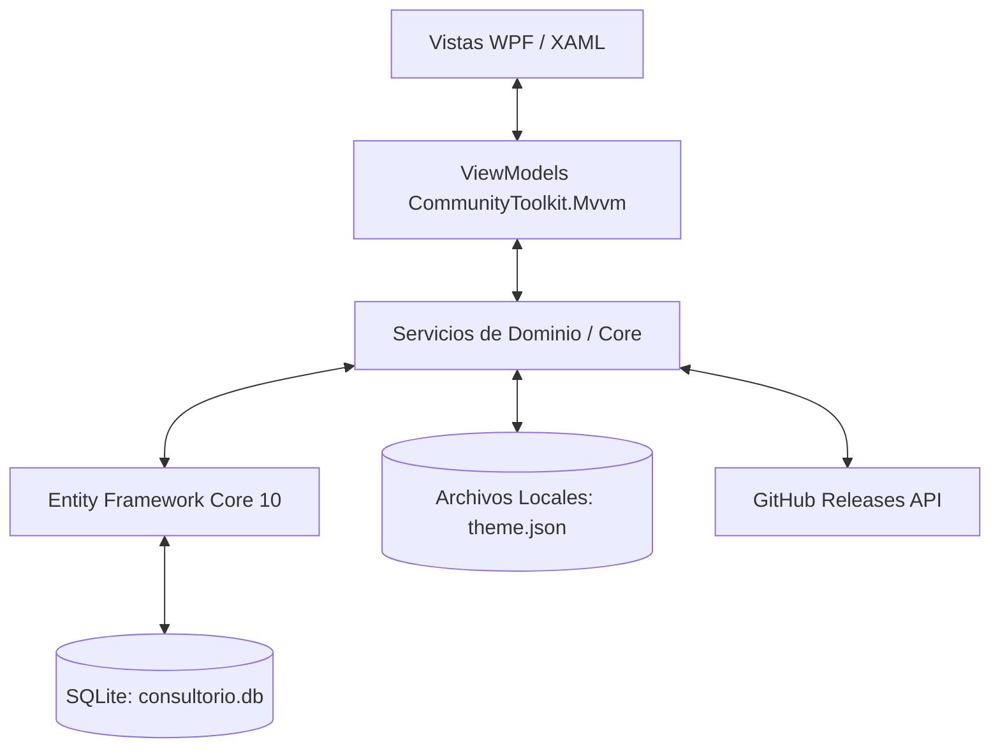
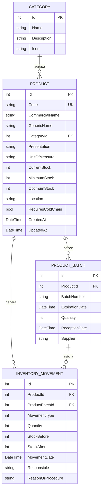
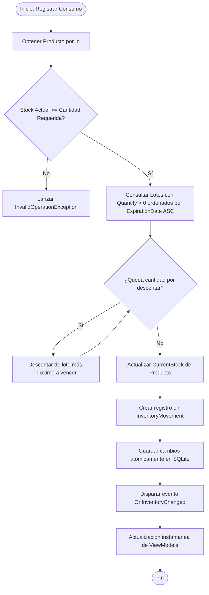

# Arquitectura Técnica - Sistema TPVC

Documentación técnica de arquitectura, diseño de software y decisiones de ingeniería para el sistema **TPVC (Inventario para Consultorio de Médico General)**.

---

## 1. Visión General de la Solución

TPVC es una aplicación de escritorio nativa para **Windows** desarrollada bajo la plataforma **.NET 10** y el framework de interfaz de usuario **WPF (Windows Presentation Foundation)**. El sistema está diseñado bajo una arquitectura desacoplada basada en el patrón de diseño **MVVM (Model - View - ViewModel)**, respaldada por un motor de base de datos relacional local **SQLite** administrado a través de **Entity Framework Core 10**.



### Principios de Diseño
1. **Desacoplamiento Estricto**: Las vistas no contienen lógica de negocio; interactúan con los ViewModels exclusivamente mediante *Data Binding* y comandos (`IRelayCommand`).
2. **Reactividad Automática sin Botones Manuales**: El `InventoryService` expone un bus de eventos en memoria (`OnInventoryChanged`) que notifica a todos los ViewModels activos ante cualquier mutación de datos (creación, edición, eliminación o consumo de insumos), refrescando el estado del sistema en tiempo real.
3. **Persistencia Autónoma y Portabilidad**: Cero dependencias de servicios en la nube para la operación clínica cotidiana. La base de datos es un archivo único `.db` alojado en el directorio de datos locales del usuario (`%LocalAppData%\TPVC\consultorio.db`).
4. **Seguridad Sanitaria Garantizada (FEFO)**: Todo consumo médico prioriza automáticamente la deducción de los lotes con fecha de caducidad más próxima.

---

## 2. Diagrama Entidad - Relación (Modelo de Datos)

El modelo de datos relacional está optimizado para garantizar trazabilidad histórica y auditoría clínica inmutable:



### Enumeraciones de Dominio
* **`MovementType`**:
  * `0`: `EntradaCompra` (Ingreso por factura de compra)
  * `1`: `EntradaReposicion` (Resurtido interno)
  * `2`: `SalidaConsulta` (Material aplicado o consumido en consulta médica)
  * `3`: `SalidaCaducidad` (Baja de insumo por vencimiento)
  * `4`: `SalidaMerma` (Material dañado o rotura de esterilidad)
  * `5`: `AjusteInventario` (Alineación con conteo físico)
* **`ExpirationStatus`** (Calculado en tiempo de ejecución):
  * `Vigente`: Expiración a más de 60 días naturales.
  * `ProximoAVencer`: Expiración dentro de los próximos 60 días naturales.
  * `Vencido`: Fecha de expiración anterior a la fecha actual (`DateTime.Today`).

---

## 3. Algoritmo de Consumo FEFO (*First Expired, First Out*)

Cuando un profesional registra un consumo rápido en consulta médica, el `InventoryService` ejecuta la siguiente secuencia atómica:



---

## 4. Motor de Temas y Estilos Dinámicos

La personalización de la interfaz se implementa a nivel del `ResourceDictionary` raíz de la aplicación mediante el servicio `ThemeService`:

### Estructura de Recursos Dinámicos (`Styles.xaml` & `ThemeService.cs`)
* `WindowBackgroundBrush`: Pincel de fondo de la ventana principal y diálogos.
* `CardBackgroundBrush`: Pincel de tarjetas de métricas, contenedores y paneles.
* `TextPrimaryBrush` / `TextSecondaryBrush`: Pinceles para textos de alta y media legibilidad.
* `PrimaryAccentBrush`: Pincel de marca aplicado a botones de acción, tabs activas y resaltados.
* `BorderBrush`: Pincel para divisores y bordes de tablas.

### Flujo de Inicialización y Persistencia:
1. Al iniciar `App.xaml.cs`, el `ThemeService` verifica la existencia de `%LocalAppData%\TPVC\theme.json`.
2. Si existe, deserializa `ThemeSettings` y aplica en caliente las variables de color sobre `Application.Current.Resources`.
3. Si no existe, genera el tema por defecto (*Modo Claro Clínico* con acento *Cian Médico* `#0284C7`).
4. Cada cambio en el selector de temas de `SettingsViewModel` invoca `themeService.ApplyTheme(settings)` y persiste inmediatamente los cambios en el disco.

---

## 5. Arquitectura del Módulo de Actualización

El servicio `AppUpdateService` proporciona verificación de versiones directas con GitHub Releases:

* **Endpoint**: `https://api.github.com/repos/Marioalr/TPVC/releases/latest`
* **Comparación Semántica**:
  ```csharp
  Version current = Version.Parse(CurrentVersion); // ej. 1.0.0
  Version latest = Version.Parse(releaseTag.TrimStart('v')); // ej. 1.1.0
  bool isUpdateAvailable = latest > current;
  ```
* **Descarga Segura**: Descarga el archivo de distribución empaquetado (`.zip` o `.exe`) hacia la carpeta temporal del usuario y ofrece apertura asistida.
* **Aislamiento**: El componente reside de manera limpia y exclusiva en la pantalla de **Ajustes**, eliminando dependencias de interfaces de usuario externas.

---

## 6. Estructura de Proyectos y Carpetas

```text
TPVC/
├── .github/
│   └── workflows/
│       └── ci.yml               # Pipeline de integración continua (Build & Test)
├── docs/
│   ├── MANUAL_DE_USUARIO.md     # Guía detallada para el personal médico
│   └── ARQUITECTURA_TECNICA.md  # Este documento de ingeniería
├── Data/
│   ├── AppDbContext.cs          # Contexto EF Core SQLite
│   └── DatabaseInitializer.cs   # Migración y sembrado clínico inicial
├── Models/
│   ├── Category.cs              # Entidad categoría médica
│   ├── Product.cs               # Entidad insumo / fármaco
│   ├── ProductBatch.cs          # Entidad lote y control de vencimiento
│   ├── InventoryMovement.cs     # Entidad movimiento de Kardex
│   └── ThemeSettings.cs         # Modelo de configuración visual
├── Services/
│   ├── InventoryService.cs      # Lógica de negocio e inventario (FEFO)
│   ├── ThemeService.cs          # Motor de renderizado dinámico de temas
│   └── AppUpdateService.cs      # Cliente de actualización vía GitHub Releases
├── ViewModels/
│   ├── MainViewModel.cs         # Orquestación de navegación y status bar
│   ├── DashboardViewModel.cs    # Métricas clínicas y consumo rápido
│   ├── InventoryViewModel.cs    # Catálogo, búsquedas y filtros
│   ├── BatchesViewModel.cs      # Control de lotes y semáforos
│   ├── MovementsViewModel.cs    # Auditoría de Kardex
│   ├── SettingsViewModel.cs     # Configuración de temas y actualizador
│   └── ProductDialogViewModel.cs # Formulario de alta y edición
├── Views/
│   ├── MainWindow.xaml          # Ventana principal y barra de estado inferior
│   ├── DashboardView.xaml       # Panel de control
│   ├── InventoryView.xaml       # Vista de catálogo
│   ├── BatchesView.xaml         # Vista de lotes
│   ├── MovementsView.xaml       # Vista de movimientos
│   ├── SettingsView.xaml        # Vista de ajustes
│   └── ProductDialog.xaml       # Diálogo modal de producto
├── tests/
│   └── TPVC.Tests/
│       ├── InventoryTests.cs    # Suite de pruebas unitarias
│       └── TPVC.Tests.csproj    # Proyecto de pruebas MSTest
├── TPVC.csproj                  # Archivo de proyecto principal WPF .NET 10
├── TPVC.sln                     # Solución Visual Studio
├── CHANGELOG.md                 # Historial de versiones Keep a Changelog
├── LICENSE                      # Licencia de código abierto MIT
└── README.md                    # Portada y documentación de inicio rápido
```

---

## 7. Estrategia de Pruebas Automatizadas

El proyecto incluye pruebas automatizadas en `tests/TPVC.Tests` utilizando **MSTest v3.5**:
1. **`DatabaseInitializer_SeedsGeneralMedicineCategoriesAndProducts`**: Valida que la base de datos cree e inserte correctamente las 5 categorías esenciales y los insumos iniciales de medicina general.
2. **`RegisterQuickConsultationUsage_DecreasesStockAndCreatesKardexMovement`**: Valida que el consumo en consulta descuente el stock del producto y genere el movimiento correspondiente en el Kardex con su responsable y motivo.
3. **`ProductBatch_ComputesExpirationStatusCorrectly`**: Valida la lógica de semáforo temporal (`Vigente`, `ProximoAVencer`, `Vencido`) en función de los días restantes.
4. **`DashboardMetrics_CalculatesCorrectTotals`**: Valida el cómputo de métricas agregadas en tiempo real.
5. **`AppUpdateService_HasValidCurrentVersion`**: Valida que la versión ensamblada esté disponible para el actualizador.
