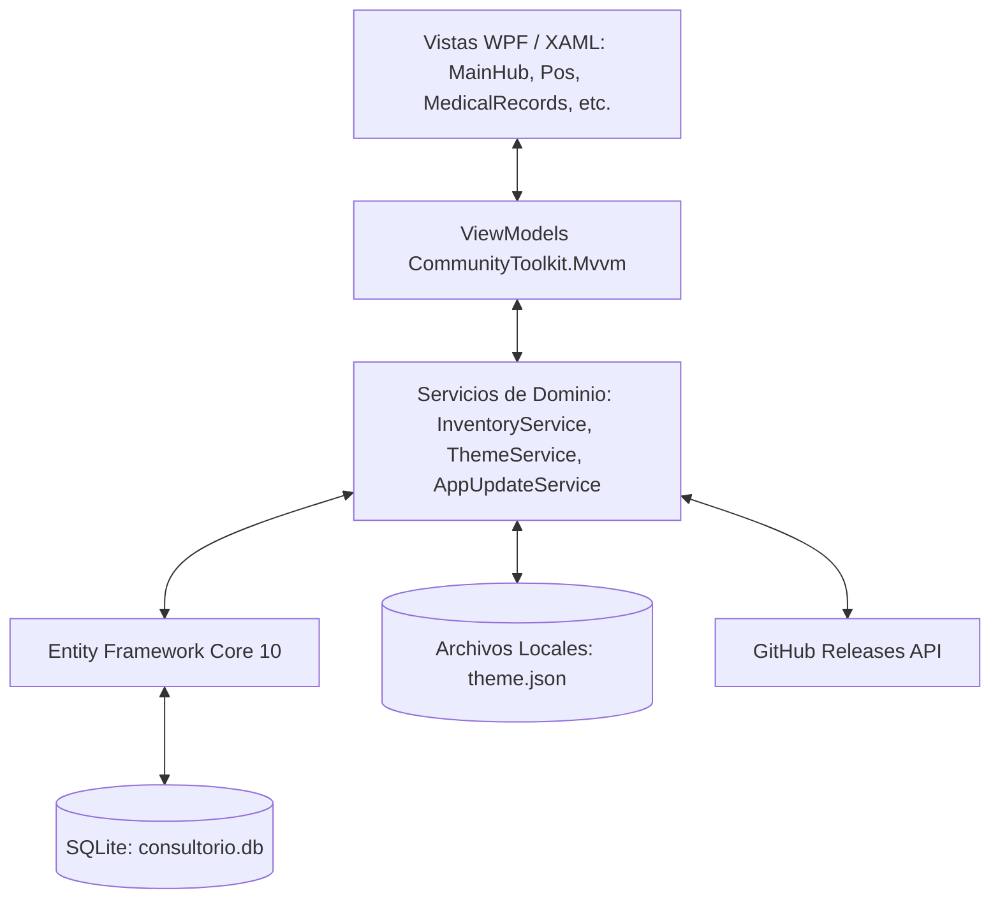
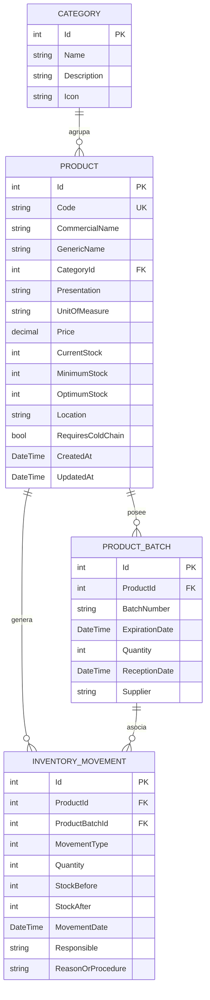

# Arquitectura Técnica - Sistema TPVC

Documentación técnica de arquitectura, diseño de software y decisiones de ingeniería para el sistema **TPVC (Inventario y Consultorio de Médico General)**.

---

## 1. Visión General de la Solución

TPVC es una aplicación de escritorio nativa para **Windows** desarrollada bajo la plataforma **.NET 10** y el framework de interfaz de usuario **WPF (Windows Presentation Foundation)**. El sistema está diseñado bajo una arquitectura desacoplada basada en el patrón de diseño **MVVM (Model - View - ViewModel)**, respaldada por un motor de base de datos relacional local **SQLite** administrado a través de **Entity Framework Core 10**.



### Principios de Diseño
1. **Vista Principal Dividida Operativa**: La vista inicial integra los dos pilares del flujo de trabajo clínico: **Expedientes Clínicos (TODO)** y **Punto de Venta (POS con Carrito)**, permitiendo conmutar entre vista dividida y vistas de pantalla completa.
2. **Reactividad Automática sin Botones Manuales**: El `InventoryService` expone un bus de eventos en memoria (`OnInventoryChanged`) que notifica a todos los ViewModels activos ante cualquier mutación de datos (compras, consumos, ventas o ajustes), refrescando el estado del sistema en tiempo real.
3. **Persistencia Autónoma y Portabilidad**: Cero dependencias de servicios en la nube para la operación clínica cotidiana. La base de datos es un archivo único `.db` alojado en el directorio de datos locales del usuario (`%LocalAppData%\TPVC\consultorio.db`).
4. **Seguridad Sanitaria Garantizada (FEFO)**: Tanto el consumo en consulta como las ventas en el POS priorizan automáticamente la deducción de los lotes con fecha de caducidad más próxima.

---

## 2. Diagrama Entidad - Relación (Modelo de Datos)

El modelo de datos relacional está optimizado para garantizar trazabilidad histórica, auditoría inmutable y soporte de venta comercial / interna:



### Enumeraciones de Dominio
* **`MovementType`**:
  * `0`: `EntradaCompra` (Ingreso por factura de compra)
  * `1`: `EntradaAjuste` (Resurtido / donación)
  * `2`: `SalidaConsulta` (Material aplicado o consumido en consulta médica)
  * `3`: `SalidaCaducidad` (Baja de insumo por vencimiento)
  * `4`: `SalidaMerma` (Material dañado o rotura de esterilidad)
  * `5`: `AjusteInventario` (Alineación con conteo físico)
  * `6`: `SalidaVenta` (Venta en farmacia / Punto de Venta POS)
* **`ExpirationStatus`** (Calculado en tiempo de ejecución):
  * `Vigente`: Expiración a más de 60 días naturales.
  * `ProximoAVencer`: Expiración dentro de los próximos 60 días naturales.
  * `Vencido`: Fecha de expiración anterior a la fecha actual (`DateTime.Today`).

---

## 3. Algoritmo de Venta y Despacho en Punto de Venta (POS)

Cuando el personal procesa una venta en el Punto de Venta con Carrito, se ejecuta una transacción atómica que implementa **FEFO** sobre cada partida:


---

## 4. Arquitectura de la Vista Principal (Hub Central de Dos Cards)

La Vista Principal (`MainHubView`) actúa como pantalla de bienvenida enfocada y libre de distracciones con **dos tarjetas interactivas de gran formato** (`BigActionCardStyle`):
* **Card 1: "Nueva Venta"**:
  * Ejecuta `OpenNewSaleCommand` en `MainHubViewModel`, delegando la navegación a `PosView` a través de `MainViewModel.NavigateTo("Pos")`.
  * Abre el flujo completo del Punto de Venta con catálogo reactivo, control de carrito, selección de método de pago y despacho FEFO.
* **Card 2: "Nueva Consulta"**:
  * Ejecuta `OpenNewConsultationCommand` en `MainHubViewModel`, delegando la navegación a `MedicalRecordsView` a través de `MainViewModel.NavigateTo("Records")`.
  * Abre el visualizador maestro-detalle de expedientes clínicos, signos vitales, notas médicas y prescripciones.
* **Navegación de Retorno Rápido**:
  * Tanto `PosView` como `MedicalRecordsView` cuentan con el botón **"← Volver a Inicio"** (`BackToHubCommand`), permitiendo al médico o asistente regresar inmediatamente a la pantalla de las dos tarjetas sin perder el estado de la sesión.
* **Interconexión Clínica**:
  * `MainViewModel` implementa el delegado `OnSendPrescriptionToPos`, permitiendo que el botón *"Cargar a Venta (POS)"* en el expediente del paciente envíe automáticamente los medicamentos recetados al carrito de compras del POS prellenando el nombre del paciente y navegando fluidamente al POS.

---

## 5. Motor de Temas y Estilos Dinámicos

La personalización de la interfaz se implementa a nivel del `ResourceDictionary` raíz de la aplicación mediante el servicio `ThemeService`:

### Estructura de Recursos Dinámicos (`Styles.xaml` & `ThemeService.cs`)
* `WindowBackgroundBrush`: Pincel de fondo de la ventana principal y diálogos.
* `CardBackgroundBrush`: Pincel de tarjetas de métricas, contenedores y paneles.
* `TextPrimaryBrush` / `TextSecondaryBrush`: Pinceles para textos de alta y media legibilidad.
* `PrimaryAccentBrush`: Pincel de marca aplicado a botones de acción, tabs activas y resaltados.
* `BorderBrush`: Pincel para divisores y bordes de tablas.

---

## 6. Estructura de Proyectos y Carpetas

```text
TPVC/
├── .github/
│   └── workflows/
│       └── ci.yml               # Pipeline de integración continua (Build & Test)
├── docs/
│   ├── MANUAL_DE_USUARIO.md     # Guía detallada para el personal médico
│   └── ARQUITECTURA_TECNICA.md  # Este documento de ingeniería
├── Data/
│   ├── AppDbContext.cs          # Contexto EF Core SQLite
│   └── DatabaseInitializer.cs   # Migración preventiva y sembrado clínico
├── Models/
│   ├── Category.cs              # Entidad categoría médica
│   ├── Product.cs               # Entidad insumo / fármaco (con Price)
│   ├── ProductBatch.cs          # Entidad lote y control de vencimiento
│   ├── InventoryMovement.cs     # Entidad movimiento de Kardex (con SalidaVenta)
│   ├── PatientRecord.cs         # Modelo de expediente clínico del paciente
│   └── ThemeSettings.cs         # Modelo de configuración visual
├── Services/
│   ├── InventoryService.cs      # Lógica de inventario, FEFO y RegisterSaleAsync
│   ├── ThemeService.cs          # Motor de renderizado dinámico de temas
│   └── AppUpdateService.cs      # Cliente de actualización vía GitHub Releases
├── ViewModels/
│   ├── MainViewModel.cs         # Orquestación de navegación y status bar
│   ├── MainHubViewModel.cs      # Orquestador de Vista Principal (Dividida / Full)
│   ├── PosViewModel.cs          # Punto de Venta, catálogo y Carrito de compras
│   ├── MedicalRecordsViewModel.cs # Expedientes clínicos y recetas (TODO)
│   ├── DashboardViewModel.cs    # Métricas clínicas y KPIs
│   ├── InventoryViewModel.cs    # Catálogo, búsquedas y filtros
│   ├── BatchesViewModel.cs      # Control de lotes y semáforos
│   ├── MovementsViewModel.cs    # Auditoría de Kardex
│   ├── SettingsViewModel.cs     # Configuración de temas y actualizador
│   └── ProductDialogViewModel.cs # Formulario de alta y edición con precio
├── Views/
│   ├── MainWindow.xaml          # Ventana principal y barra de estado inferior
│   ├── MainHubView.xaml         # Vista principal dividida
│   ├── PosView.xaml             # Vista de Punto de Venta con Carrito
│   ├── MedicalRecordsView.xaml  # Vista de Expedientes Clínicos (TODO)
│   ├── DashboardView.xaml       # Panel de control y métricas
│   ├── InventoryView.xaml       # Vista de catálogo
│   ├── BatchesView.xaml         # Vista de lotes
│   ├── MovementsView.xaml       # Vista de movimientos
│   ├── SettingsView.xaml        # Vista de ajustes
│   └── ProductDialog.xaml       # Diálogo modal de producto
├── tests/
│   └── TPVC.Tests/
│       ├── InventoryTests.cs    # Suite de 8 pruebas unitarias
│       └── TPVC.Tests.csproj    # Proyecto de pruebas MSTest
├── TPVC.csproj                  # Archivo de proyecto principal WPF .NET 10
├── TPVC.sln                     # Solución Visual Studio
├── CHANGELOG.md                 # Historial de versiones Keep a Changelog
├── LICENSE                      # Licencia de código abierto MIT
└── README.md                    # Portada y documentación de inicio rápido
```

---

## 7. Estrategia de Pruebas Automatizadas

El proyecto incluye 8 pruebas unitarias automatizadas en `tests/TPVC.Tests` utilizando **MSTest v3.5**:
1. **`DatabaseInitializer_SeedsGeneralMedicineCategoriesAndProducts`**: Valida el sembrado clínico inicial.
2. **`RegisterQuickConsultationUsage_DecreasesStockAndCreatesKardexMovement`**: Valida consumo en consulta con FEFO.
3. **`ProductBatch_ComputesExpirationStatusCorrectly`**: Valida la lógica de semáforo temporal.
4. **`DashboardMetrics_CalculatesCorrectTotals`**: Valida cómputo de KPIs agregados.
5. **`AppUpdateService_HasValidCurrentVersion`**: Valida el ensamblado de versiones.
6. **`RegisterSaleAsync_DecreasesStockAndCreatesSalidaVentaMovement`**: Valida la transacción de venta POS, deducción de existencias y registro en Kardex de tipo `SalidaVenta`.
7. **`PosViewModel_CartCalculationsAndLimitsWorkCorrectly`**: Valida operaciones del carrito de compra (agregar, incrementar sin exceder existencias, decrementar, vaciar y totales).
8. **`MedicalRecordsViewModel_LoadsPatientsAndDispatchesPrescriptions`**: Valida la carga de expedientes y el despacho de recetas al carrito del POS.
