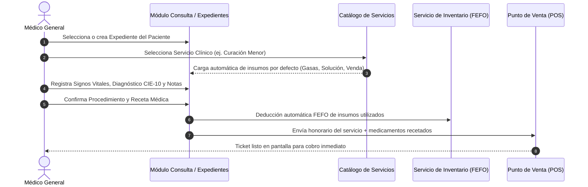
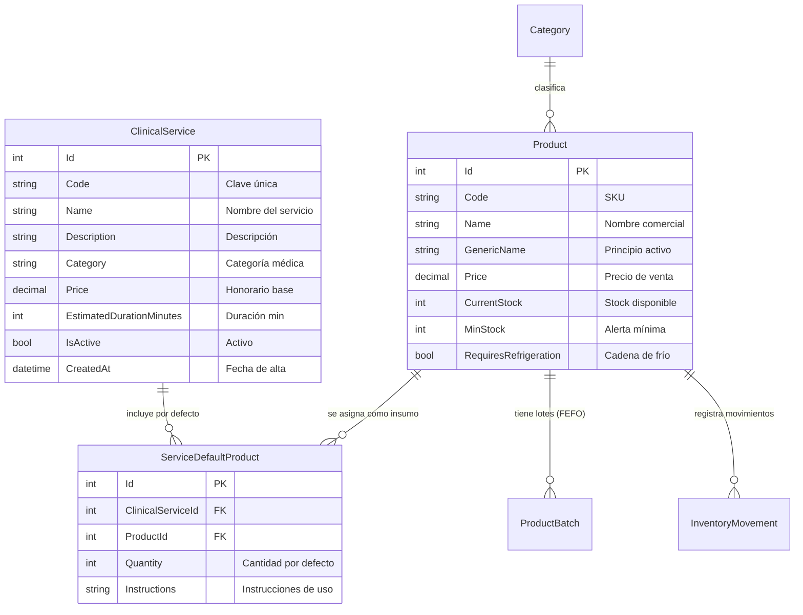

# Plan de Consulta Médica y Catálogo de Servicios Clínicos (TODO)

## 📋 Introducción y Alcance
Este documento describe la arquitectura funcional y técnica para el módulo de **Consulta Médica y Servicios Clínicos** en el sistema **TPVC** para consultorios de medicina general.

La consulta médica integra de forma nativa la historia clínica del paciente con el control de inventario y el punto de venta (POS), permitiendo:
1. Configurar un **Catálogo de Servicios Clínicos** (ej. *Consulta General*, *Curación Menor*, *Sutura*, *Nebulización*, *Lavado Ótico*, *Certificado Médico*).
2. Asociar a cada servicio un conjunto de **Productos e Insumos por Defecto** tomados del inventario.
3. Descontar automáticamente mediante **FEFO** (*First Expired, First Out*) los insumos utilizados al realizar el procedimiento.
4. Trasladar los honorarios del servicio y los medicamentos recetados directamente al **Punto de Venta (POS)** para su cobro en un solo clic.

---

## 🏥 Catálogo de Servicios Clínicos y Paquetes de Insumos

### 1. Definición del Servicio
Cada servicio médico se modela como una prestación clínica con:
* **Código Identificador**: Clave única (ej. `SERV-001`, `SERV-002`).
* **Nombre del Servicio**: Descripción formal del acto médico.
* **Categoría Clínica**: Clasificación funcional (*Consulta*, *Curaciones*, *Procedimientos Menores*, *Diagnóstico*, *Certificados*).
* **Honorario / Precio Base ($ MXN)**: Tarifa estándar del servicio.
* **Duración Estimada**: Tiempo aproximado de atención en minutos.
* **Insumos y Fármacos Predeterminados**: Lista configurable de productos del catálogo de inventario requeridos de forma rutinaria para brindar el servicio.

### 2. Insumos por Defecto por Tipo de Servicio

| Código | Servicio Clínico | Categoría | Honorario | Insumos por Defecto Vinculados | Cantidad Predeterminada |
| :--- | :--- | :--- | :---: | :--- | :---: |
| **SERV-001** | Consulta Médica General | Consulta | \$300.00 | Alcohol Etílico 70% Desnaturalizado Abatelenguas de madera | 1 dosis 1 pieza |
| **SERV-002** | Curación Menor y Asepsia | Curaciones | \$250.00 | Gasa Estéril 10x10 cm Solución Fisiológica 0.9% 250ml Venda Elástica 10 cm | 2 piezas 1 frasco 1 pieza |
| **SERV-003** | Sutura de Herida Simple | Procedimientos | \$450.00 | Lidocaína Simple / Epinefrina Sutura Nylon 3-0 / 4-0 Gasa Estéril 10x10 cm Solución Antiséptica | 1 ampolleta 1 sobre 2 piezas 1 frasco |
| **SERV-004** | Monitoreo de Glucemia Capilar | Diagnóstico | \$80.00 | Tiras Reactivas Glucosa Capilar Lancetas estériles Torunda con Alcohol 70% | 1 tira 1 lanceta 1 pieza |
| **SERV-005** | Nebulización Terapéutica | Procedimientos | \$200.00 | Mascarilla para Nebulizar Adulto/Ped. Solución Fisiológica 0.9% ampolleta Salbutamol Solución para Nebulizar | 1 pieza 1 ampolleta 1 dosis |
| **SERV-006** | Lavado Ótico / Extracción de Cerumen | Procedimientos | \$300.00 | Solución para irrigación ótica Jeringa para lavado de 20ml / bulbo | 1 frasco 1 pieza |
| **SERV-007** | Certificado Médico Oficial | Certificados | \$200.00 | Formato oficial membretado y foliado Insumos de somatometría básica | 1 formato 1 kit |

---

## 🔄 Flujo de Trabajo en Consulta y Venta

---

## 🏗️ Modelo de Datos (Diagrama Entidad-Relación)

---

## ⚖️ Alineación Normativa Mexicana (NOM-004-SSA3-2012)
El plan de consulta está estructurado para cumplir cabalmente con las directrices de la **Norma Oficial Mexicana NOM-004-SSA3-2012 del Expediente Clínico**:
1. **Historia Clínica y Ficha de Identificación**: Datos generales, edad, género, grupo sanguíneo, teléfono y contactos de emergencia.
2. **Alertas Sanitarias de Alergias**: Visibilidad obligatoria destacada en rojo de alergias medicamentosas de riesgo vital (Penicilina, Sulfas, AINEs).
3. **Somatometría y Signos Vitales**: Tensión Arterial (TA), Frecuencia Cardíaca (FC), Frecuencia Respiratoria (FR), Temperatura (°C), Peso corporal (kg), Talla y Glucosa capilar.
4. **Notas Médicas de Evolución**: Motivo de consulta, padecimiento actual, exploración física detallada, diagnóstico nosológico y plan terapéutico.
5. **Prescripción Farmacológica Legal**: Emisión de recetas con cédula profesional, nombre genérico obligatorio, posología, vía de administración y código QR de validación.
